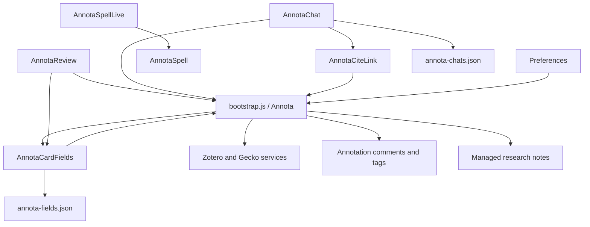

## Public beta milestone (2026-11-22)

The 2.43.0-beta.1 milestone supersedes the prior deletion-regeneration policy: intentional managed-note deletion persists a management tombstone until explicit Recreate / Resume management. Add inline palette actions and packaged logo; per-note color order with explicit one-time rebuilds in all modes; previewed native highlight color mapping with persistent jobs, recoverable journals and conflict-aware Undo. Preserve structured data and PDF bytes; never import embedded annotations automatically or generate AI during mapping. See BETA_READINESS.md, INSTALLATION.md and CHANGELOG.md for current behavior and compatibility.

## Reliability milestone update (2026-11-22)

Shared managed-note ownership now distinguishes deleted notes from unavailable native items, backs up released bindings, and keeps update modes unchanged. Runtime compilation fails closed without initialized infrastructure. Color commits are independent of downstream note refresh errors. Library-aware note-modes jobs reuse existing storage, checkpoints and reconciliation. Chat includes preflight in busy-state cleanup, honors explicitly corrected retry settings, recovers rebuildable index failures and distinguishes explicit note context from PDF evidence. See RELIABILITY_AUDIT.md.

## Integrated refinement update (2026-11-17)

The integrated refinement layer adds note-presentation.js for context-aware titles and same-library destination validation. Stable configuration/native note identities remain independent of titles and placement. Unchanged compiler output plus semantic equality retains normalized editor HTML; changed entries still use annotation-level reconciliation. Chat persists retrieved and actually supplied evidence separately. See REFINEMENT_AUDIT.md.

# Current architecture

## Dual-mode Chat and UI/UX consolidation (2026-11-17)

See UI_UX_DESIGN.md. The new research-chat-window.js coordinator wraps the existing
Chat renderer, shared conversation objects, history and persistent job services.
The native XHTML host loads the same renderer. No second search, provider, index,
AI or capture engine is introduced. Conversation uiState carries question/capture
drafts and capture job identities; history writes use infrastructure serialization.
Both views receive message/source/retrieval/capture/job updates. Render signatures
avoid destroying unchanged forms. Expand is single-flight and single-window;
return/close does not restart requests. Shutdown closes the native window, removes
listeners and flushes existing history. Geometry is bounded and locally remembered.

Workspace uses shared native CSS; Chat styling is scoped so Zotero annotation
controls are unaffected. Notes uses a five-step presentation over its existing
service, with separate management. Explorer cards foreground annotations and keep
secondary actions collapsed. Network uses a question list/detail layout and array
based role editing. Existing note identities/reconciliation, review, AI triggers,
structured storage and all Production Readiness deferrals remain unchanged.

## Source-grounded Chat, Capture Evidence and note defaults (2026-11-17)

The integrated milestone adds research-chat.js (local page-aware index, inverted keyword index, optional embedding vectors/hybrid retrieval, bounded source context and validated citation snapshots), research-chat-ui.js (adapter over existing Chat sidebar/history/provider/Markdown) and evidence-capture.js (recoverable native annotation operations). Existing provider credentials/models, AI lifecycle, structured storage, atomic infrastructure writes, jobs and managed-note reconciliation remain authoritative. Rebuildable indexes are local files outside portable research backups; scientific capture provenance remains in infrastructure.evidenceCaptures. MD5-based evidence/operation identities avoid short-hash identity collisions. Reader arguments cross compartments explicitly; stored passage geometry is plain JSON. Native getAnnotations uses its ID-returning form.

Capture reserves native keys before writes, reuses matching highlights, preserves Comments/Tags/completed AI, and suppresses ordinary creation-time Automatic AI for journaled keys. Explicit optional AI uses shared structured-ai child jobs, eligible only after the parent capture completes; single-concurrency queues do not deadlock. Cancellation guards child enqueue and cascades to dependencies. Guarded AI completion updates undo ownership only while unrelated author content remains unchanged. Checkpoint replay retains original undo snapshots. New note-default jobs preview/confirm replacement and use existing backup/reconciliation/repair/guards. Four settings sections are siblings with visible boundaries; Notes/Network disclose existing controls progressively. Explorer/Saved Searches/Activity keep their interfaces, with only parent-job status integration. See [RESEARCH_CHAT.md](RESEARCH_CHAT.md).


## Research Knowledge Network (2026-11-16)

The current milestone adds research-network.js and the Network HTML/SVG view inside the existing workspace. The optional version-1 infrastructure network document contains stable relationship types, explicit relationships, research questions, topic-source field IDs, suggestion review records and durable discovery batch markers. Existing atomic mutation/recovery, full backups/import journals, AI jobs/provider safeguards, Explorer projection and annotation-level managed compiler remain authoritative. No independent database, generation pipeline, primary window, toolbar button or visualization dependency is added.

Relationships are library-aware, typed and revision checked. Inverse/symmetric displays derive from one record; duplicate pairs and self-links are rejected. Deletions retain tombstones and unavailable references remain. Topics derive from existing categorical field/value IDs. AI suggestions are an isolated human-review queue; only accepted proposals create AI-assisted relationships. Graph traversal uses entity/type indices with bounded depth/nodes/edges. Shared Network notes retain source links, stable entry IDs, positioned authored content and new Network completeness fingerprints/expected-record guards, alongside all existing protections. Native testing also corrected two inherited backup validators without discarding active or archived definitions. [Full architecture and workflows](RESEARCH_KNOWLEDGE_NETWORK.md). Earlier Network deferrals below are historical.


## Shared AI creation policy and persistent jobs (2026-11-16)

Annota.aiGenerationTrigger reads each color/area's existing trigger; absent values mean auto. Trigger-only entries retain preferences for global-only AI definitions. handleItem persists manual fields, then calls requestAIFields only for Automatic. requestAIFields delegates to AnnotaInfrastructure.generateJob; sidebar, existing popup and per-field Retry reuse that path. Explorer uses the same persistent structured-ai handler. Manual-mode generation controls are derived from policy plus missing/failed/running field state. No renderer starts automatic generation. Palette changes refresh presentation only.

Jobs filter completed values before enqueue, deduplicate stable annotation/field sets and recheck values during execution. Explicit retry resumes a failed job with acknowledgement; creation never resumes failed paid work. Partial successes persist with lifecycle metadata and managed-note synchronization. Pre-request validation failures are persisted as failed lifecycle states. Shared provider calls disable Zotero HTTP-level server/throttle retry (errorDelayMax=0; noRetryOnThrottle=true), discovered in actual Zotero source/runtime; the existing job manager alone retries positively rejected rate limits. Chat's separate retry policy remains intact. All note reconciliation, identity, guards and repair backups remain unchanged.


## Workspace usability architecture (2026-11-16)

The native shell loads Gecko global and Zotero styles so dynamically created native select popups receive their required interaction and theme rules. Popup backgrounds use Canvas/CanvasText; native selection remains unchanged. Field editors render conditional controls before potentially rejecting draft persistence; instruction drafts are keyed by stable field identity in a settings preference, separate from annotation values. Existing services own search, notes, AI and jobs. Group metadata is generated once as the existing publication entry; PDF inclusion defaults are minimal and explicit saved configurations override them. See [WORKSPACE_USABILITY.md](WORKSPACE_USABILITY.md) for inventory, migration and validation boundaries.


## Unified native workspace and annotation reconciliation (2026-11-16)

`research-workspace.js` owns one window, chrome registration, local geometry/section
preferences, diagnostics and per-main-window Tools/toolbar integration. The XUL
shell and `research-workspace-window.js` mount existing Explorer/Notes HTML views
once; Saved Searches/Activity reuse those controllers through a small host API.
Selection context updates across main windows. Section descriptors reserve an
extension point without adding a Knowledge Network view. All storage/search/AI/
note/job logic remains in its existing services.

Shared notes use `reconcileEntries` to match normalized annotation-level fragments
and retain each identity's user tail. New entries follow configured order after
attached user blocks; deletion falls back to the preceding survivor/introduction;
reordering carries the user tail. Generated boundary rules and presentation wrappers
are reconciled without raw whitespace growth. The prior repair/restoration and
incomplete-data guards remain. Existing `AnnotaReview` now reports partial missing
fields and shared AI lifecycle states. See [RESEARCH_WORKSPACE.md](RESEARCH_WORKSPACE.md).

## Shared managed-note correction and Research Explorer (2026-11-16)

The priority recursive-snapshot fix removes the whole-document preservation
fallback. Shared notes now use semantic block ownership/replacement, normalized
text/link comparisons, invisible identity/data link metadata and backup-first
repair/restore. PDF ownership records publish after native save. Local owned note
keys preserve identity if title metadata is edited. Incomplete-data guards remain.
See [MANAGED_NOTE_REPAIR.md](MANAGED_NOTE_REPAIR.md); earlier whole-document snapshot
descriptions are historical and must not be reintroduced.

`research-explorer.js` loads after Research Notes and installs a disposable scoped
projection/query service over native items and indexed structured reads. It shares
cold discovery, caches up to three scopes, time-slices/cancels queries and updates
cached rows on native/structured/AI metadata changes. The XHTML/window script uses
shared field builders and strict expected-value saves. Saved queries use the
existing portable settings allowlist. Explorer note generation passes the stored
query to the current dashboard/job/compiler path; it has no separate note engine.
See [RESEARCH_EXPLORER.md](RESEARCH_EXPLORER.md) for every work package and limits.

## Research Note Generation architecture (2026-11-16)

`research-notes.js` loads after infrastructure initialization and registers a
`research-notes` handler with the existing persistent manager. It resolves scopes,
computes lifecycle summaries, matches stable field/category/color IDs and invokes
the shared generator and managed-note engine. Tools opens `research-notes.xhtml`;
`research-notes-dashboard.js` presents forms, preview, management and progress.
The existing annotation renderer/compiler gains detailed content inclusion.
Generic notes gain PDF-style completeness fingerprints/counts and prior-record
checks. Actual local ownership snapshots, not configuration presence or portable
job payloads, establish ownership. Item notifications and durable field saves
debounce automatic generic-note updates without AI. Existing PDF identities,
queues, storage schema, portability and shutdown drain remain in use. See
[RESEARCH_NOTE_GENERATION.md](RESEARCH_NOTE_GENERATION.md). Earlier absent-dashboard
statements are superseded for this authorized milestone.

## Data Infrastructure architecture (2026-11-16)

This section supersedes historical descriptions of unsafe active batch/review,
version-2 root storage, absent shutdown flushing and absent reusable note/jobs
infrastructure. Foundation/customization are functionally accepted; visual polish
is deferred. See [DATA_INFRASTRUCTURE.md](DATA_INFRASTRUCTURE.md) for the full contract
and [SYNCHRONIZATION.md](SYNCHRONIZATION.md) for the blocked sync decision.

- New active module infrastructure.js loads after card-fields.js, before storage
  migration, sidebar registration and annotation notifiers. It installs storage
  validation/recovery adapters, durable metadata, a managed-note service and jobs.
- annota-fields.json root schema 3 retains record schema 2 and unknown historical
  fields. Serialized atomic writes keep last-good recovery and immutable session/
  migration snapshots. researchannotator-infrastructure.json schema 1 persists
  jobs, note configs and local ownership; portable v1 backups optionally carry
  configs/jobs, excluding local note HTML ownership/cache data.
- bootstrap.js retains the individual generation pipeline and PDF attachment
  rebuild queue. Its shared _renderManagedAnnotationEntry also serves generic
  compilation. Awaited shutdown drains drafts, notes and storage; no new events
  register before storage recovery. New structured-ai/pdf-note handlers use stable
  library/item identities. Direct creation/Retry preserve automatic behavior.
- review.js and inherited batch actions integrate shared jobs rather than generating
  structured data into Comment. Refill keeps atomic structured before/after backups;
  guarded undo skips later edits. Conversion source registration precedes native
  conversion and transfers structured records without deleting historical data.
- preferences-data.js adds minimal pause/resume/cancel/progress controls; preferences
  expose scheduled AI concurrency. The full batch dashboard is not implemented.
- Local note completeness guards prevent destructive deficient-device rebuilds;
  this does not establish cross-device convergence. No automatic sync transport is
  enabled. Existing styles/palette rendering remain unchanged.


## Color layout geometry refinement (2026-11-16)

The shared palette renderer now supports single/wrap/stack/slanted/vertical using the existing preference key. Single Row measures complete labels (including reserved selection-mark width), sums their intrinsic widths and expands the shared popup up to the reader viewport minus 24px. Slanted packs disjoint rotated rectangles at 35-55 degrees using transformed geometry; Vertical rotates whole labels by -90 degrees and uses the longest label for equal heights. Geometric layouts use measured DOM dimensions, per-picker mutation/viewport observers and one scheduled animation-frame measurement. Observers detach on removal/unload/shutdown. Slots ignore pointer events while native transformed buttons retain their full hit regions. Wrap and Stacked retain their previous CSS and sizing; geometry rules are scoped to the other three layouts. No stored annotation data or preference value migration is involved.

Collapsed color rows now expose an accessible trash button; protected deletion choices appear outside a closed details element. Existing usage checks, confirmation, archive and reassignment are reused.


## Usability refinement layer (2026-11-16)

- `bootstrap.js` stores `researchannotator.suggestionDismissals` as
  `{fieldID:[categoryID,...]}`. Suggestions filter these IDs; categories, original
  labels, stored assignments and chips are not removed. Restore clears suppression
  and reuses the ID. Shared multi-select menus use grid rows with independent
  selection/dismiss buttons, retaining arrow/Enter/Escape selection and keyboard
  access to dismissal. This applies through the existing shared renderer in all
  three annotation interfaces; no separate sidebar component was added.
- `_orderAnnotationControls` establishes native Comment/Tags before the global-first
  structured schema. Existing native nodes move without cloning/replacing their
  handlers. Both popups use one responsive 360px width cap, 8px padding, field-sizing
  and vertical-scroll rule. Top-layer/portal menus remain outside overflow clipping.
- `palette.js` shares `stylePicker`/`styleButton` between popup renderers. Layout
  modes, semantic labels, pointer/hover/focus/pressed feedback and selection marks
  are common. White text uses a dark overlay where needed (contrast headroom for
  hover); a separate original-color swatch preserves the actual highlight color.
- `usage`, `deleteColor` and `reassignAndArchive` distinguish permanent removal
  from archiving. Usage inspects native annotations, original/stable stored color
  records, categorical/AI history, reassignment references and pending drafts.
  Only confirmed unused custom colors can be removed; legacy preference mirrors
  are cleaned so they cannot resurrect the configuration. Category IDs/annotation
  JSON are never deleted. Used colors remain archived with stable identity; optional
  native recoloring runs in a Zotero transaction and preserves source and target
  structured records separately. Dirty fields, active AI/imports and read-only
  annotations prevent unsafe reassignment; rollback preserves original colors.
- `preferences-data.js` renders closed native `details` rows with compact summaries,
  keyboard/drag reorder handles, counts and explicit destructive confirmations.
  One existing `preferences.js` field editor is parked in a hidden container and
  moved into the expanded row. `colorPreferences.select/flush` saves the old row
  before switching; editor DOM/listeners, highlight/area selection, raw syntax,
  individual prompts, layouts and reset behavior are retained. Counts refresh on
  saves without rebuilding the editor. Reordering accepts only its custom drag
  MIME type, leaving ordinary text drops into prompts/fields untouched.
- `data-manager.js` includes optional dismissal preferences in settings/research/
  backup envelopes, validation and import journals; old envelopes remain accepted.
  Palette `custom` metadata is optional for older backups, with a conservative
  native-color fallback. The internal/portable format versions remain unchanged.

This layer changes presentation and safe configuration management, not the shared
AI pipeline or note compiler. Existing native Comments/Tags, migrated research data,
generation locks, deletion synchronization and backup/recovery behavior remain.
Mocked coverage does not establish live reader geometry, drag/focus, screen-reader
behavior or actual light/dark visual acceptance.

## Integrated milestone: palette, native Comment and portable state

This section supersedes the older Phase 1-only boundary below for the six approved
work packages. The working tree remains uncommitted; build inventories identify
the actual packaged bytes, not HEAD alone.

| Module | Responsibility |
| --- | --- |
| `bootstrap.js` | Native creation Comment drafts scoped by attachment and exact normalized text; shared popup layout/scrolling; global-first schemas, safe individual AI and existing serialized note compiler |
| [palette.js](palette.js) | Stable palette configuration, original-hex aliases, frozen field IDs, presets, archiving/reorder, explicit transactional recoloring, contrast/semantic buttons, guarded reader creation adapter |
| `card-fields.js` | Atomic serialized v2 JSON writes with flush; reads stable color records before legacy hex records; retains both, global values, field IDs, AI metadata and imported historical/status information |
| [data-manager.js](data-manager.js) | Portable formats/validation, library matching, consistent structured-state snapshots, conflict previews, merge/replace, secret exclusion, automatic backups, local import journal/recovery and AI/import guards |
| `preferences.js`, `preferences.xhtml`, [preferences-data.js](preferences-data.js) | Existing schema editor and new palette/Data Management controls; reviewed import plans, library mapping and post-import field editor refresh |

`researchannotator.palette` contains `{version:1,preset,colors:[...]}`. Each color
has stable `p_*` identity, current hex, historical aliases, semantic label, archive
flag and separate text/image configurations. Initial migration freezes the old
hex-derived field IDs; newly configured fields also receive persistent IDs.
Native annotations retain Zotero's actual hexadecimal color. Future-only hex edits
retain old aliases; recoloring writes native annotation colors in a Zotero DB
transaction. Neither deletes values. Presets archive unused configurations and
preserve labels/definitions rather than replacing them destructively.

`annota-fields.json` remains version 2: each annotation retains `colors[hex]`
history and gains `colorConfigs[p_id]` / `colorConfigs[image:p_id]`. Stable records
take precedence; raw names/`valuesByID`, globals and AI metadata retain their
existing roles. Source files are not renamed and historical records are not erased.

Portable JSON has `format:"ResearchAnnotator"`, `version:1`, and kind `settings`,
`research` or `backup`. Settings contain typed preferences; JSON preferences are
objects in the portable format. An explicit inventory excludes credential prefs,
executable paths, detection caches and installation identity. URL credentials and
sensitive query parameters are removed; known configured secrets are redacted.
Scientific keys such as `token` are retained. Library-local migration checkpoints
are not portable. Collection scopes use portable library identities and collection
keys, not numeric library IDs.

Research records identify a user account or Zotero group by stable external ID,
then annotation key, attachment key, type and text. Unsigned personal libraries
use a local installation identity and require explicit mapping elsewhere. Matching
never falls back to numeric library IDs or text alone. Missing/deleted/read-only or
inconsistent records are reported, not reassigned. Orphans remain recovery-only.
Historical tag/note metadata, category identities, saved AI results and generation
snapshots travel with the data. Historical-only assignments in read-only/partially
migrated libraries are included without altering their original tags/preferences.

Import validates first, previews changes/conflicts/unmatched identities, checks
that data has not changed since preview and blocks active provider operations.
It backs up current complete extension state and the received document under
`researchannotator-backups` before mutation. It then writes a local pending
`researchannotator-import-journal.json` containing the original local store and
portable preference snapshot. Store writes use an atomic temporary file and flush;
preferences flush before the journal is marked complete. Failed application rolls
back; an incomplete rollback blocks further structured writes until recovery.
Startup recovery precedes palette/global migration. Recovery journals deliberately
use this installation's local IDs and are never used as cross-device import files.

Import never writes Zotero items, native Comments or ordinary/managed notes, and
never invokes a provider. It restores running statuses as interrupted/retryable.
Automatic annotation-driven note synchronization otherwise uses the same existing
compiler/queue. No separate note engine, batch pipeline or automatic cloud sync
was introduced. Independently created conflicting palette identities are rejected
for merge and require explicit replacement; raw historical data/backups remain.

Installed API inspection: `C:/Program Files/Zotero/app/omni.ja`,
`chrome/content/zotero/xpcom/reader.js`, `xpcom/annotations.js`,
`xpcom/data/library.js` and `resource/reader/reader.js`. SelectionPopup spreads
the selected annotation plus type/color into the annotation manager and has no
built-in Comment editor. The extension provides pre-save native Comment entry;
native creation fallback saves its scoped draft through the item-add path. The
custom palette adapter uses the guarded private annotation manager API and native
`annotationColor`/DB writes, leaving native controls visible if creation support
is absent. Exact reader-version behavior still requires live testing.

The accessible preset starts from the primary
[Okabe-Ito Color Universal Design palette](https://jfly.uni-koeln.de/color/).
[Zotero reader documentation](https://www.zotero.org/support/pdf_reader) describes
the native selection/color workflow. Neither source establishes full compatibility
of this extension's private adapter; labels and contrast-aware button text do not
substitute for visual, keyboard and color-vision acceptance tests.

## Phase 1 global fields implementation

The approved managed-note unit is a PDF; existing attachment-key identities are
preserved. This section records the earlier Phase 1 foundation; the milestone above
adds the specifically authorized palette/manual-portability work.

- `bootstrap.js` owns global definitions, stable IDs, merged individual schemas,
  categorical catalogs, the reusable multi-select, legacy migration and per-field
  generation. `fieldsForColor` remains color-only for inherited workflows;
  `annotationFields` combines global/color definitions for individual interfaces
  and PDF notes. Runtime global names are stable IDs; display labels can collide.
- `preferences.js` reuses the visual editor for global add/edit/order/remove.
  `preferences.xhtml` places the Global Fields card immediately after Highlight
  Colors with the same card/title styling.
  Internal global IDs are hidden/read-only. Color schema column six can retain a
  stable ID through variable/display-name changes. Definition archives, label
  history and aliases retain recovery/presentation information after changes.
- `card-fields.js` adds `globalValues` beside existing color records in the
  version-2 file. Color records add `valuesByID` without deleting legacy name keys.
  Existing reads remain compatible; saves merge current values and acknowledge disk
  completion. Global values are annotation-owned, independent of current color.
- Categorical selections store stable value IDs, with labels in the
  `researchannotator.fieldCategories` preference. Global definitions are in
  `researchannotator.globalFields`; color-name aliases are in `fieldAliases`.
  Options are suggestions, not restrictions; old categories remain available.
- AI successes store `aiMetadata[fieldId]` with scope, exact prompt, fingerprint
  and generation time. Field request/status keys include annotation and scope;
  global locks are independent of annotation color. Status/errors are transient.
  Automatic creation and row retries use incremental mode, preserving successful
  fields when another fails. The default atomic API mode remains available for
  compatibility. No batch/review UI was added or refactored.
- Legacy Theme/Experiments tags, catalogs and metadata notes are copied without
  deletion. Definitions are checkpointed first; value imports skip existing values
  (including deliberately empty arrays). Per-library completion checkpoints allow
  failed runs to resume. Existing managed notes refresh without provider requests
  or creation of new notes. Failed/read-only libraries retain original data; the
  redundant dedicated category/comment controls are removed regardless of migration
  completion. Writable failures retry on startup. Historical `researchComment`
  values copy to `g_legacy_comment`, a configurable textarea created only when
  historical comments exist. Original metadata and native Comment remain unchanged.
  The old `_migrateResearchMetadataToTags` entry point now delegates to this safe
  migration, retaining metadata notes rather than erasing them. Note rebuilding
  no longer writes historical research comments into native Comment.
- `createMultiSelect` is shared by creation, existing-popup and sidebar fields.
  Category suggestions are normalized/deduplicated and isolated by field ID.
  Removable chips, filtered suggestions and a distinct Create row share keyboard
  handling and combobox/listbox semantics. Suggestions use a fixed-position native
  popover top layer where supported, otherwise a body-level portal; viewport
  bounds, scroll/resize dismissal and removal cleanup avoid clipping/stale menus.
  Reader focus/outside-click behavior and actual theme contrast require live checks.
- Each failed AI field gets its own Retry below the response/error. Multi-selects
  use the same field boxes in all interfaces; a small Global/Color marker identifies
  scope. PDF-note presentation converts category IDs to labels and recognizes
  historical global labels during normalized-HTML replacement.

No sync-mode/inclusion configuration, cross-paper note compiler, dashboard or
retroactive batch action is implemented. The shared generator is callable for
historical annotations by future orchestration; schema IDs and prompt snapshots
support future outdated-value detection and resumable processing.

## UI and field-output formatting update

Automatic individual generation remains unchanged. Popup/sidebar controls are
now failure-only Retry, driven by the existing transient generation state.
Core `normalizeAIFieldValue` removes exact leading configured labels;
`aiFieldHTML` and `renderAIField` share conservative formatted presentation for
new and historical AI values. UI rendering creates text/allowed formatting DOM
nodes; it does not inject provider HTML. Historical structured JSON is untouched.
Only individual requests use raw provider output plus field-content instructions;
batch/review defaults remain unchanged. Shared field CSS supplies compact,
theme-aware containers in all three interfaces; Retry text is localized.

Managed note entries are joined by native horizontal rules. Replacement includes
boundary-adjacent plain or normalized div-wrapped rules, while preserving unrelated
note regions. Rule identity does not depend on custom HTML attributes surviving
Zotero normalization. Prior architecture sections describe historical stages and
are superseded by this update where applicable.

## Automatic generation and deletion update

Item-add handling now saves manual draft patches and invokes the existing shared
individual-field generator even for AI-only schemas. Add-event identity is
deduplicated for the session; opening views, storage reload and modify events do
not initiate generation. Transient per-annotation/color status in card fields
refreshes all watched views with running/error/success state. Native creation
Add to Note is suppressed with a scoped reader stylesheet.

Deletion resolves the attachment via cached annotation identity or existing
managed-note markers/links, and queues an attachment rebuild even when no
annotations remain. Tombstones exclude stale cache results and late AI saves.
Managed ranges are replaced without discarding unrelated note suffix content;
normalized headings plus known field paragraphs are recognized when Zotero
strips wrapper attributes. These changes supersede corresponding historical
baseline descriptions below; batch/review generation remains unchanged.

## Focused implementation update

Individual structured-field paths now share `Annota.generateStructuredFields`
and awaitable `AnnotaCardFields.saveValues`. The generator fills only empty AI
fields, requires all requested results to succeed, rechecks annotation identity,
and merges results without overwriting values changed during the request.
Manual drafts are saved first. Native Comment is not written by these paths.
Disk writes serialize; individual saves publish after successful writes and
reject unreadable storage. The existing version-2 format is retained.

Creation, clicked-highlight popup and sidebar use the full field schema with
read-only AI labels/placeholders. Popup/sidebar explicit actions use the shared
generator; watched views refresh saved results without replacing dirty manual
drafts. Manual saves patch edited fields and allow empty values. New individual
views do not infer structured values from native Comment. Automatic generation
on creation, batch/review, legacy parsing helpers and unrelated lifecycle/note
identity logic are unchanged. The audit sections below record the prior baseline;
consult BUGS.md for scoped implementation status and runtime uncertainties.

Baseline recorded 2026-11-15. Read with [REQUIREMENTS.md](REQUIREMENTS.md),
[BUGS.md](BUGS.md), [ROADMAP.md](ROADMAP.md) and [TESTING.md](TESTING.md).
This describes the working tree, including existing uncommitted changes, not
necessarily the extension installed in Zotero. Git HEAD at inspection was
`63f630ba1974a4615f06c255f2d86e14b2a9ae66`; that commit alone cannot reproduce
the working tree. No source, release configuration or Zotero data was changed
to establish this baseline.

## Extension identity and source boundary

`manifest.json` identifies ResearchAnnotator 2.42.0, add-on ID
`researchannotator@pino`, with declared Zotero compatibility 7.0 through
10.0.*. This declaration is not evidence of runtime verification on every
supported version. The README and many internal names still refer to Annota.

The runtime is a bootstrap-based JavaScript extension. There is no conventional
module import graph: `Services.scriptloader.loadSubScript` loads modules into
shared scope. `Annota` is the central service object. Zotero and Gecko provide
items, notes, preferences, searches, notifications, DOM access, HTTP, file I/O
and subprocess facilities.

The development packager and release workflow list 17 active files: the ten
JavaScript files below, `manifest.json`, `preferences.xhtml`, `preferences.css`,
`chat.svg`, and `icon32.png`, `icon48.png`, `icon96.png`.

| Source | Responsibility and important functions |
| --- | --- |
| `bootstrap.js` | Lifecycle; `Annota`; schema/configuration; notifier; selection and existing-highlight popups; providers; batch processing; metadata; consolidated notes; conversion; collection controls |
| `card-fields.js` | `AnnotaCardFields`: load/get/remember/persist structured values; resolve legacy comments; sidebar rendering; autosave; AI action |
| `review.js` | `AnnotaReview`: review by color; AI fill; selective refill; comment-based undo |
| `chat.js` | `AnnotaChat`: document/library retrieval, chat panel/history, citations, note proposals and save-to-note |
| `citelink.js` | `AnnotaCiteLink`: annotation-aware citation serialization, editor interception, navigation, copy/export links, note reduction and undo |
| `spell.js` | `AnnotaSpell`: macOS spelling/grammar checker, visible-text mapping and corrections |
| `spell-live.js` | `AnnotaSpellLive`: document scans, typing listeners, CSS highlights and correction popovers |
| `preferences.js` | Settings UI behavior, schema linting, provider controls and detection, semantic labels and import/export |
| `prefs.js` | Default preferences under `extensions.zotero.researchannotator.*` |
| `i18n.js` | English/French translation dictionaries |

`bootstrap.before-*`, `*.backup-*`, `*.bak`, `bootstrap.candidate.js`, recovery
files, patch temporary files and the unusual `trap...` files are outside the
active load and packaging lists. Preserve them; filenames do not establish
that they are working rollback versions. XPI files are packaged artifacts,
not active source. Packaging/release helpers are `build.sh`, `package-dev.ps1`,
`release.sh`, `make-updates.py` and `.github/workflows/release.yml`.

## Dependencies



The core/card dependency is circular: core workflows rely on storage owned by
the sidebar module, while that module calls core schema, generation and note
services. Review also depends on card parsing and comment composition.
Optional citation helpers support review navigation and backup I/O fallback.

## Lifecycle and events

`startup` migrates saved Annota preferences, initializes `Annota`, loads
translations, registers item/reader listeners, then loads optional modules.
It exposes `Zotero.Annota`, registers preferences and language observation,
and adds controls to existing windows. Main-window load/unload hooks maintain
menus and chat controls. Optional module failures are logged separately.

| Mechanism | Purpose |
| --- | --- |
| Item notifier: add/modify/delete | New annotation handling; delayed note rebuild; deletion cleanup |
| `renderTextSelectionPopup` | Semantic colors, general research capture, color fields and chat action |
| `renderSidebarAnnotationHeader` | Sidebar card hook, fields and AI button |
| `createAnnotationContextMenu` | Explicit generation, spelling and chat |
| Chat tab notifier | Context and panel refresh |
| Card MutationObserver | Restore/rebuild fields after direct child changes |
| 500 ms popup interval | Locate existing-highlight popup using private reader state |
| Live spelling scans/listeners | Find editors, check typed text and offer corrections |
| Language preference observer | Relocalize supported controls |

Shutdown unregisters many listeners, stops chat/live spelling, restores citation
patches and removes window controls. The popup scan interval is not explicitly
cleared. Card storage has no explicit durable flush at shutdown. Attachment
sync timers/queues and outstanding work also lack a coordinated shutdown drain.

## Annotation flow

1. Selection rendering reads color configuration through `fieldsForColor`.
   Schema syntax is `name | label | type | options/instruction | format`.
   Supported types are text, textarea, check, select and ai. Image annotations
   use separate `image:#hex` configuration keys.
2. Creation renders the full schema, including read-only AI placeholders.
   Manual values enter the global `_pendingFields` buffer. General comment,
   tags, themes and experiments use a separate `_pendingResearch` buffer.
3. The add notifier handles conversion first, then general research metadata,
   performs an initial consolidated-note sync, and calls `handleItem`.
4. Current `handleItem` saves nonempty pending structured values and requests
   another note sync. It does not call `buildComment` or an AI provider.
   AI-only creation therefore does not generate through this route.
5. Existing sidebar cards use `AnnotaCardFields` and the full schema. The
   clicked-highlight popup uses `_renderExistingAnnotationResearch` and
   `visibleFieldsFor`, which excludes AI fields. These are separate renderers.
6. Sidebar manual saves update JSON and the note without writing native Comment,
   but skip saving when every manual value is empty. Popup saves merge manual
   values with the stored record. Color switching saves the old color first.
7. Explicit sidebar AI, review/refill and batch generation use `buildComment`.
   It resolves references, generates empty per-field AI values, optionally fills
   empty manual fields using the color prompt, optionally generates whole-comment
   AI output, and renders a template. It returns structured values via `out`.
8. These generation callers still write native Comment differently: sidebar AI
   appends a marked block, batch replaces Comment, review/refill compose and
   replace it. Comment independence is incomplete.
9. Item modification schedules a 1200 ms debounced note rebuild. Structured
   JSON-only edits request sync explicitly. Rebuilds serialize per attachment;
   metadata changes serialize per library.
10. Deletion uses wrapper/marker removal separately from rebuild queues.
    Conversion migrates research metadata but does not migrate card JSON keys.
11. Restart reloads preferences and persisted JSON. Pending buffers are lost.
    No automatic startup-wide consolidated-note reconciliation is wired.

## Storage and authority

| Data | Current location and representation | Important limits |
| --- | --- | --- |
| Provider/settings/schema | Zotero preferences, `researchannotator.*`; `colorPrompts` JSON | Settings parsing/normalization duplicated in preferences and core |
| Semantic color labels | `researchannotator.colorLabels` JSON | Separate from each field configuration's `label` |
| Structured values | Data directory `annota-fields.json`, version 2 | Local file; no Zotero-sync integration found |
| Native Comment | Zotero annotation `annotationComment` | Still used as both user content and generated output by older paths |
| Themes/experiments | Automatic annotation tags `RA:Theme:*`, `RA:Experiment:*` | Catalog suggestions derive from active assignments |
| Ordinary tags | Native annotation tags | Research tags filtered from ordinary tag presentation in notes |
| Consolidated notes | Native Zotero notes | Identity is attachment key, not bibliographic paper key |
| Legacy research metadata | Marked metadata note with JSON in a pre block | Migration/read helpers remain; migration is not wired into startup |
| Chat history | Data directory `annota-chats.json` | Optional local history; delayed writes and bounded history |
| Refill undo | `annota/sauvegardes-ia/relance-*.json` | Saves comments before/after, not structured snapshots |
| Note-reduction undo | `annota/sauvegardes-notes` | Separate from refill backups |
| Apple adapter | Generated Swift source/binary in data directory | Compiled on demand; macOS-specific |

Structured file shape:

```text
annotations["libraryID/annotationKey"].colors["#hex" or "image:#hex"]
  values: { fieldName: value }
  references: string
  comment: string
```

`remember` replaces the current color record in memory, then schedules disk
write after one second. It is not awaitable durable storage. A temporary file
is used for writing; failures are logged. Store loading supports earlier
single-color records and can infer legacy fields from default-layout comments.
That parsing fallback is not used by every consumer.

## Consolidated-note behavior

`_getOrCreatePaperResearchNote` uses marker
`research-annotator-pdf-note-v1:<attachmentKey>` and places the note under the
bibliographic parent when present; standalone attachments get standalone notes.
`_syncPaperResearchNoteNow` searches annotations, loads research tags and JSON,
and renders numbered entries, native comments, fields, tags, themes and
experiments. It sorts by PDF position or color, with links back to annotations.
Missing AI values become `Not generated yet`.

Rebuild preserves the introduction and replaces the managed suffix. It can
recognize annotation links when Zotero strips custom wrappers. Deletion and
conversion verification do not have equivalent link-based recognition.
`_syncPaperResearchNoteFromNote` remains defined but has no active caller;
two-way editing is not an established requirement.

## Feature coverage and compatibility

Inherited Annota-style tools include configurable prompts/templates, reference
resolution from PDF links/bibliography and EPUB footnotes, HTTP/Ollama/CLI/Apple
providers, batch generation and failed tags, chat/retrieval/note proposals,
annotation citations, note reduction, review/refill, spelling and collection
controls. Research workflow additions include semantic labels, themes and
experiments, consolidated attachment notes, existing-highlight controls,
conversion and per-color structured storage. These are functional groupings,
not verified commit-level authorship claims.

Private dependencies include `_readers`, `_iframeWindow`, `_internalReader`
state/conversion, editor serialization and message handlers. Syntax checks
cannot establish their compatibility across Zotero versions. Large-library
searches during note and metadata updates are a performance risk, not a
measured performance result.
