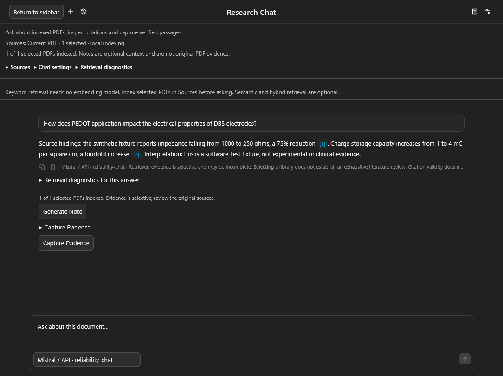
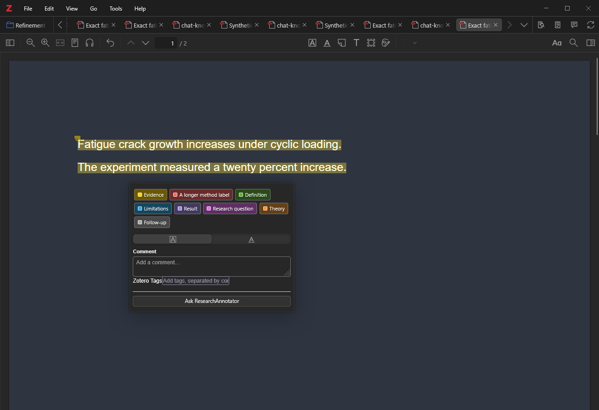
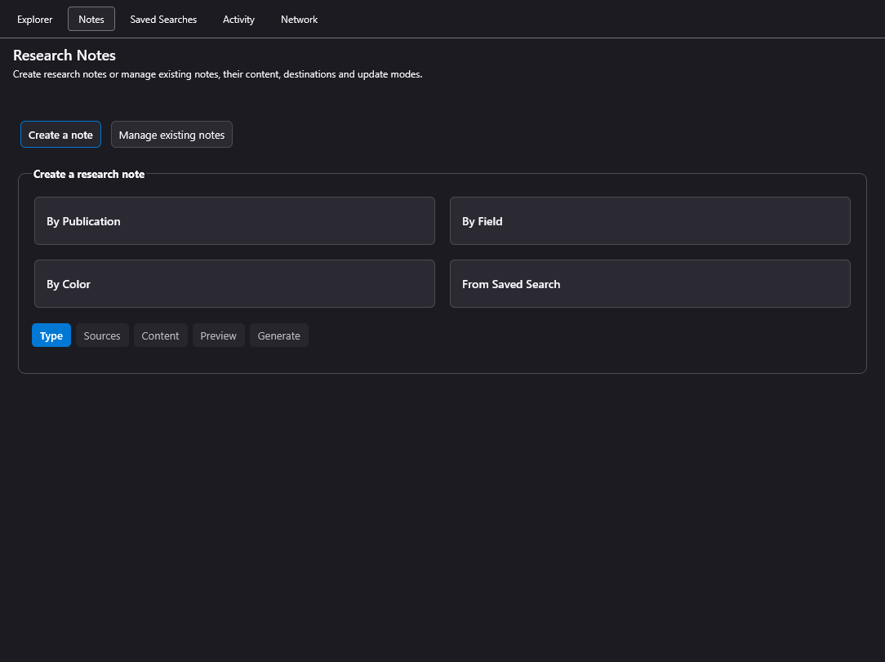
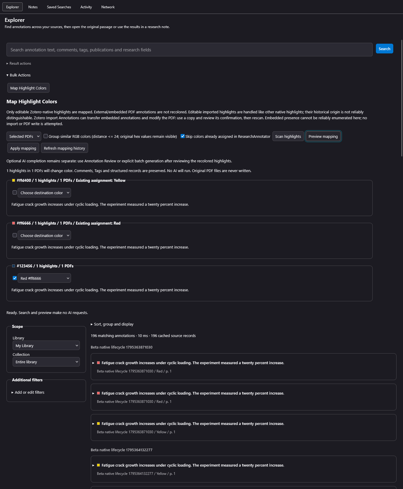

# ResearchAnnotator

**Turn PDF highlights into organized research knowledge.**

**2.43.0-beta.1 · Preview release · Windows / Zotero 10.0.8 verified**

   

*Three real beta screenshots, four seconds per step; not a continuous recording or speed measurement. Synthetic software-test papers and a simulated answer; no scientific result or model-quality claim. [Static answer](docs/assets/screenshots/chat-answer.png) · [Passage](docs/assets/screenshots/chat-passage.png) · [Capture preview](docs/assets/screenshots/chat-capture.png).*

## What ResearchAnnotator does

Connect PDF highlights, configurable manual and AI fields, consolidated research notes, annotation search, research relationships and source-grounded Chat inside Zotero. AI is optional. Native Comments and Tags remain independent of structured fields.

## Quick installation

1. Back up Zotero and export existing ResearchAnnotator data. For older development builds, open Chat once before upgrading and keep the backup.
2. Obtain the approved `ResearchAnnotator-2.43.0-beta.1.xpi` and compare its [SHA-256](SHA256SUMS.txt).
3. In Zotero: Tools → Plugins/Add-ons → gear menu → Install Add-on From File. Select the XPI; restart if requested.

**The existing Pinokuo/ResearchAnnotator repository remains private and this beta is unpublished.** The intended structure is main development, integrated guides, Releases and Issues in that same independent repository. There is no live public download to link. The current verified binary uses a private update-feed URL; later betas need manual installation. [Complete instructions](docs/installation.md).

## Core features

| Research task | Where to go |
| --- | --- |
| Assign semantic colors and structured manual/AI fields | PDF highlight popup and ResearchAnnotator settings |
| Find unfilled fields and retry AI failures | Annotation Review |
| Search annotations, fields and publications | Workspace → Explorer |
| Create/update consolidated and cross-publication notes | Workspace → Notes |
| Reuse queries and monitor work | Saved Searches and Activity |
| Organize relationships, topics and questions | Network |
| Ask questions with source citations and capture evidence | Research Chat sidebar or full-size window |
| Recolor existing editable highlights safely | Explorer → Bulk Actions → Map Highlight Colors |

*Semantic labels remain associated with stable color identities. The [visual guide](docs/user-guide.md) covers fields, review, all Workspace tabs, note management, Chat, settings and mapper limitations.*

See Notes and Bulk Color Mapper

## Getting started in five minutes

Rename one color to **Finding**, highlight one sentence, open Workspace → Notes → By Publication, preview and generate. You should see a linked quotation in a note associated with that PDF. This is a target workflow, not a measured five-minute usability claim. [Follow the beginner walkthrough](docs/installation.md#your-first-five-minutes).

## Local AI integration

Use Ollama with a downloaded local model if desired. Chat models write answers; embedding models support optional similarity retrieval. **Keyword retrieval needs no embedding model.** Index selected PDFs locally before asking source-grounded questions.

[Step-by-step local AI setup](docs/local-ai.md) · [Choose a model without scripts](docs/local-ai.md#choose-a-local-ai-model-without-running-any-scripts) · [Manual hardware tables](docs/hardware-selection.md) · [Optional Python advisor source](tools/local_ai_advisor.py)

## Detailed guides

- [Visual user guide](docs/user-guide.md): short workflows, real screenshots and expected results.
- [Installation and upgrades](docs/installation.md): no repository clone or terminal required.
- [Local AI setup](docs/local-ai.md): Windows, macOS and Linux instructions, retrieval concepts and transparent optional advisor.
- [Compatibility and beta limitations](docs/compatibility.md), [release notes](BETA_RELEASE_NOTES.md) and [changelog](CHANGELOG.md).

## Troubleshooting

Check source scope and indexed coverage first. “No indexed evidence,” “no matching passages” and “retrieval succeeded but generation failed” need different fixes. Inspect secondary retrieval diagnostics and Activity. [Troubleshooting](docs/troubleshooting.md).

## Privacy and data handling

PDF extraction and keyword indexing stay local. Generation sends the selected context to your configured provider; approved external embeddings send passages/questions. Local inference requires a local endpoint **and** a local model. Valid citations do not prove scientific correctness or an exhaustive review. [Privacy boundaries](docs/privacy.md).

## Feedback and contributing

[Report a Bug · Request a Feature · Ask a Question](docs/feedback.md) using the prepared templates after approved integration. Same-repository Issues are enabled but currently private. Share reproducible steps and redacted diagnostics, never credentials, private PDFs or full profiles. [Contribution guide](CONTRIBUTING.md).

Support is optional: [Buy Me a Coffee](https://buymeacoffee.com/researchannotator). No donation popup is added to Zotero.

## License and attribution

ResearchAnnotator derives from **Annota by Elliot Quiriconi**. The original copyright and complete [MIT license](LICENSE) remain in the distribution and XPI. Zotero and Ollama are separate projects; integration names do not imply endorsement. Historical compatibility identifiers remain where needed to preserve existing data.

## Development and project status

The independent repository uses main for primary development, GitHub Releases for distribution and same-repository Issues for feedback. It remains private; the verified beta draft is not published. [Architecture](ARCHITECTURE.md), [requirements](REQUIREMENTS.md), [roadmap](ROADMAP.md), [backlog](FEATURE_BACKLOG.md) and [testing](TESTING.md) document the implementation. Use the safe reviewed packaging workflow; inherited release scripts are not onboarding commands.

See the [private consolidation status](docs/release/private-consolidation.md) and [future update-feed proposal](docs/release/update-feed-proposal.md). Historical attribution and compatibility data are preserved.
