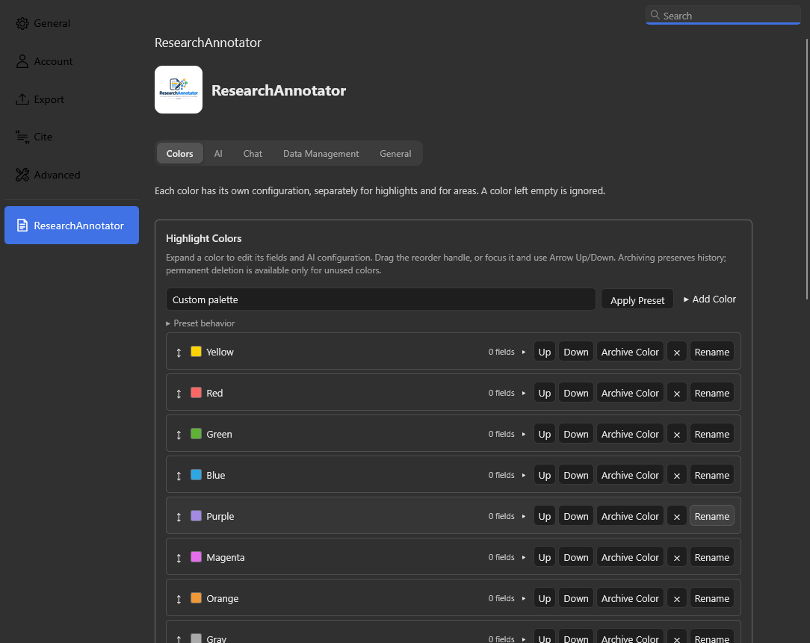
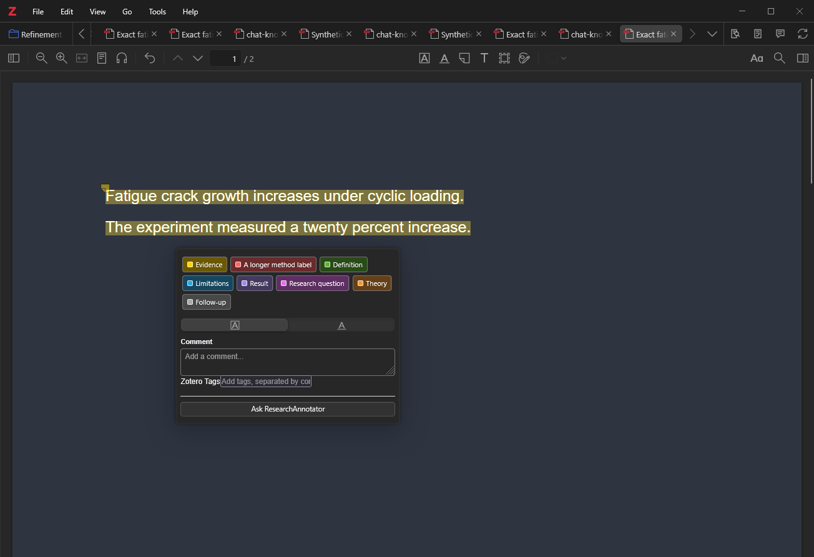
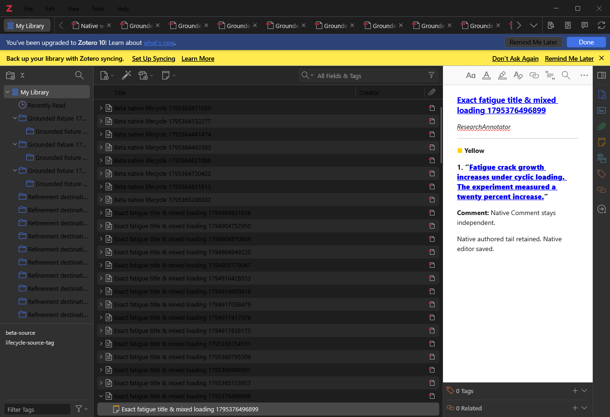

# Installation and safe upgrades

## Your first five minutes

This is a five-minute **target workflow**, not a timed usability result. Have Zotero installed, the reviewed XPI downloaded and one PDF attached to a publication. Backups and downloads may take longer; local AI/model downloads are separate and unnecessary for this first session.

| Time target | Action | What you should see |
| --- | --- | --- |
| 0–1 minute | Open Tools → Plugins/Add-ons → gear menu → Install Add-on From File. Select `ResearchAnnotator-2.43.0-beta.1.xpi`, accept the prompt and restart if requested. | ResearchAnnotator enabled in the plugin list. |
| 1–2 minutes | Open Zotero Settings and select ResearchAnnotator in the sidebar. In Colors, expand a color and use Rename to call it “Finding”; save its configuration. | Your semantic name beside the swatch. |
| 2–3 minutes | Open a PDF attached to a publication. Select a short sentence, then choose Finding in its popup. | A native Zotero highlight in that color. |
| 3–4 minutes | Open Research Workspace → Notes → By Publication. Choose the PDF/publication scope and included content. | A preview of quotations and populated data. |
| 4–5 minutes | Review the preview and Generate or update. Open the resulting note. | A research note associated with the PDF, using its publication title. |







The images come from the final packaged beta's synthetic test library. Your publication title and color names will differ. A fresh nontechnical-user timing test and screenshots of Zotero's installer dialog remain manual acceptance checks; actual XPI installation was verified previously in isolated Zotero 10.0.8.

This is a beta. The native verified environment is Windows with Zotero 10.0.8. Read [compatibility](compatibility.md) before testing on another version, operating system or group library.

## Before installation

Back up your Zotero data directory using your usual backup process. In ResearchAnnotator settings, use Data Management to export your research data. Keep both: a portable export is not a complete library backup. Do not delete existing backups.

### Download availability

Open [GitHub Releases](https://github.com/Pinokuo/ResearchAnnotator/releases) and choose ResearchAnnotator 2.43.0-beta.1. Download its XPI and SHA256SUMS.txt; the source-code ZIP is not the installable extension.

**Upgrading an older development build:** open Research Chat once before installing and preserve a backup. Older builds could write an unopened history as empty at shutdown. This beta fixes that defect for future shutdowns; it cannot repair an already empty history without a backup.

## Manual installation — no scripts

1. Download `ResearchAnnotator-2.43.0-beta.1.xpi` from the release assets. Do not download GitHub's source ZIP as the extension.
2. Compare its SHA-256 with `SHA256SUMS.txt`. On Windows, open the XPI's Properties and use an installed trusted checksum tool if available; Windows does not provide SHA-256 in the standard Properties dialog. A trusted local GUI hash utility is a no-terminal option. Do not upload the file to a random checksum website.
3. Open Zotero. Choose Tools → Plugins (called Add-ons in some versions).
4. Use the gear menu → Install Add-on From File. Select the downloaded XPI, accept Zotero's installation prompt and restart if requested.
5. Confirm ResearchAnnotator version `2.43.0-beta.1` in the plugin list. Open its settings and check colors, fields, AI triggers and provider settings before running a batch operation.

The checksum detects a mismatch against the published value; it does not establish authenticity independently of the channel publishing that value.

## Optional checksum commands

These commands only read a local file. They do not install software or execute downloaded scripts. Replace the filename with its actual local path.

Windows PowerShell:

```powershell
Get-FileHash -Algorithm SHA256 -LiteralPath '.\ResearchAnnotator-2.43.0-beta.1.xpi'
```

macOS:

```sh
shasum -a 256 ResearchAnnotator-2.43.0-beta.1.xpi
```

Linux:

```sh
sha256sum ResearchAnnotator-2.43.0-beta.1.xpi
```

## Updates and removal

Install later beta XPIs manually after reviewing their release notes. The verified beta retains its required branding-branch update URL. Its feed contains no update entries, so no automatic update is advertised even when that URL is publicly readable. Do not replace it with an inherited upstream release feed.

Disable or remove the plugin through Zotero's plugin manager. Removing the plugin is not a substitute for restoring a backup, and native annotations already created in Zotero remain library data. Keep exports before changing versions; do not assume an older extension can read newer storage schemas.
