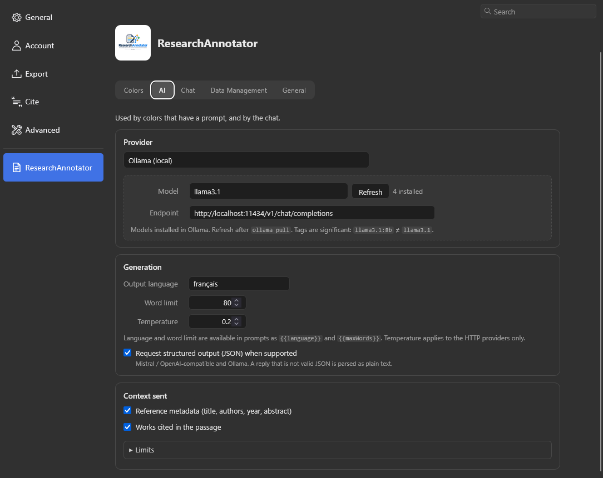
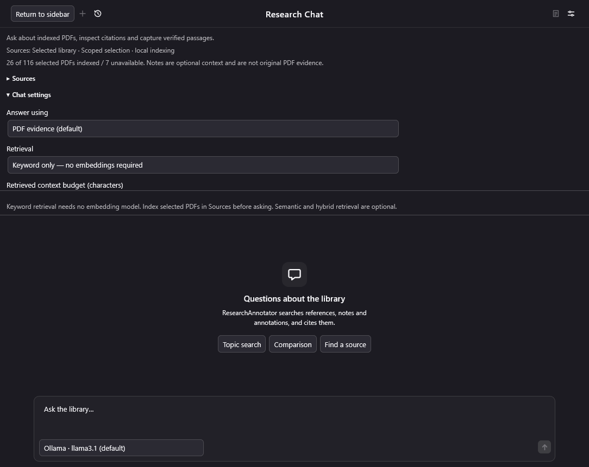
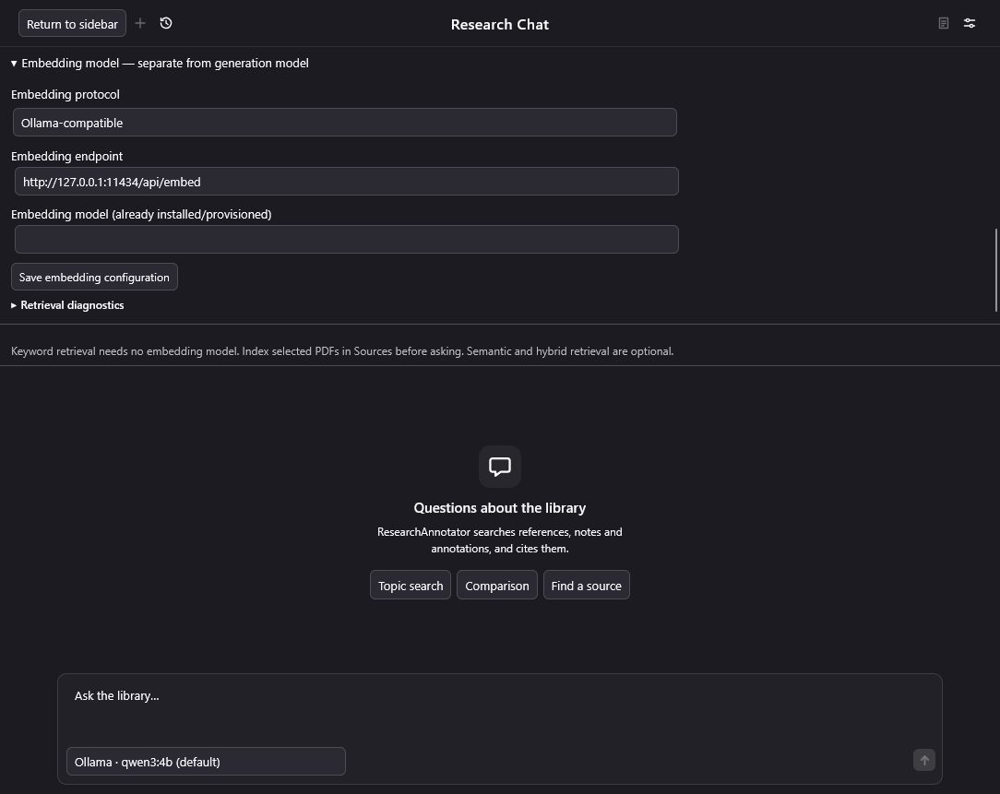
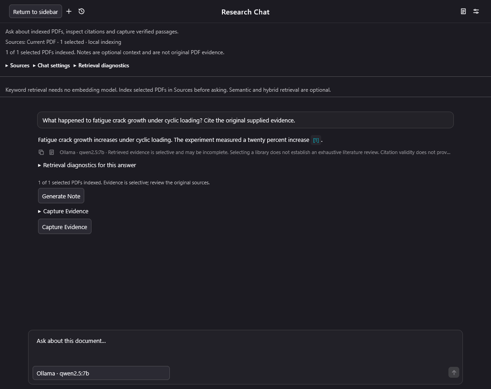

# Local AI with Ollama

Generation is optional. You can use manual fields, research notes, Explorer and keyword indexing without downloading an AI model. These instructions were checked against current official documentation on 22 November 2026 and the beta's provider settings. Loopback transport passed previous testing; the new real-model connection attempt did not pass. See the verification limit below before relying on this as a fully accepted local-AI workflow.

## Manual setup — no downloaded scripts

### Windows

Download the Windows installer from Ollama's official site, open it and follow its prompts. Launch Ollama from Start and choose a local model in its model selector. Wait for the download to finish; this can take much longer than installing ResearchAnnotator. Current vendor requirements include Windows 10 22H2 or newer; see the linked Windows requirements for drivers and storage. This is vendor support information, not a claim that this beta was tested on every such system.

### macOS

Download the official DMG, open it and drag Ollama to Applications. Open Ollama from Applications; inspect any permission prompt before accepting. Select a local model and wait for its download. Ollama currently specifies macOS 14 or newer, with Apple M-series CPU/GPU support and Intel CPU-only operation. See [Ollama for macOS](https://docs.ollama.com/macos). Native ResearchAnnotator macOS acceptance remains pending.

### Linux

There is no verified universal graphical installer in this guide. Use the current [official manual Linux installation](https://docs.ollama.com/linux), choose the archive matching your CPU architecture, download it as a file and inspect the instructions before extracting/installing it. Installation into system directories may require your administrator; the optional advisor never does. Do not use a download-to-shell pipeline. After a verified installation, `ollama serve` starts the local service if your distribution has not already started it. In a second terminal, `ollama -v` shows its version. Linux native extension and installer workflows were not run here; ask a trusted administrator if unsure.

### Connect and make a first test



*Captured in the isolated final-beta profile. A local Ollama server returned its model list; these models were not downloaded by this audit. The preserved displayed default may not be installed. Select your own actual installed tag. A model list alone is not a successful generation test.*

1. Visit [Ollama's official download page](https://ollama.com/download). Choose the installer for your operating system and inspect its origin before opening it. Do not run a copied remote installer pipeline.
2. Install and open Ollama. On Windows it runs a local service at `http://localhost:11434`; check current OS/GPU requirements in the [official Windows guide](https://docs.ollama.com/windows). Model files need additional disk space beyond the application.
3. In the Ollama application, select/download a **local** chat model when that GUI option is available. Avoid cloud-labelled models when you want on-device inference. Keep the app running. GUI availability differs by OS/version; see the [official quickstart](https://docs.ollama.com/quickstart).
4. Open ResearchAnnotator settings → AI. Choose **Ollama (local)**. Set the endpoint to `http://localhost:11434/v1/chat/completions`. Click Refresh and choose the exact installed model tag. Leave the API key blank for a local model.
5. The Chat tab can override the generation model; leave it empty to inherit the main model. This is separate from the embedding model.
6. Open Research Chat, choose a small source, index it locally and keep Retrieval set to Keyword only. Ask a short question and inspect its citation against the PDF. Use Activity to diagnose a failed job before retrying.

Ollama supports a local [OpenAI-compatible chat endpoint](https://docs.ollama.com/api/openai-compatibility). Selecting a cloud model through a local server can still involve external inference; `localhost` alone is not proof that the model runs locally. Keep the service bound locally; this guide does not require exposing it to your network.

If your installed Ollama GUI cannot download a desired model, the no-script alternative is to select a model already available through the GUI or continue without AI. Linux users should follow current official installation instructions themselves; this guide does not substitute an unverified GUI installer or ask you to execute an unfamiliar script.

## Optional, readable terminal commands

These invoke an installed program; they do not execute a downloaded installer script. Run only commands you understand. Pulling a model downloads a potentially large file and is your explicit choice.

```sh
ollama pull qwen3:4b
ollama list
ollama ps
```

After choosing and downloading the model, optionally run:

```sh
ollama run qwen3:4b
```

Ask it to reply with one short sentence, then enter `/bye` to leave the terminal conversation. `run` may download the model if it is missing: do not use it until you have chosen the model and accepted that download. This checks Ollama itself; it does not test ResearchAnnotator. In ResearchAnnotator, Refresh should list the installed model, and a short manually requested AI field or indexed-PDF Chat question tests the application connection. There is no invented dedicated Test Connection button in these instructions. Inspect Activity on failure.

### Understand the five pieces

| Piece | What it does | Required? |
| --- | --- | --- |
| Chat/generation model | Writes answers or configured AI field values from supplied context. | For generated answers/fields only. |
| Embedding model | Turns text into numerical representations for similarity search; cannot write a Chat answer. | Optional. Separately configured. |
| Keyword retrieval | Finds indexed passages using words in the question. | Default starting option; no embeddings. |
| Semantic / hybrid retrieval | Finds conceptually similar passages, or combines similarity and keywords. | Optional; needs configured embeddings and approval. |
| PDF indexing | Extracts page-aware passages locally so retrieval can find them. | Needed before PDF-grounded retrieval; does not itself ask a generation model. |

`qwen3:4b` is a concrete example, not a quality recommendation or a requirement. Its [official model page](https://ollama.com/library/qwen3:4b) currently lists roughly 2.5 GB of model weights. Runtime memory is larger and depends on context, quantization and hardware. `ollama list` shows installed tags; `ollama ps` shows running allocations. Choose a different supported local chat model if it suits your hardware or structured-output needs better.

## Optional semantic retrieval



*Scroll within the settings area to reach lower controls. This image shows keyword mode; the next image shows the actual embedding controls. Real-model embedding/indexing acceptance remains pending.*



Keyword retrieval needs no embedding model. Start there. Embeddings do not generate answers and require separate configuration.

If you deliberately want semantic/hybrid retrieval, install an embedding model compatible with your Ollama version; for example, inspect [EmbeddingGemma's requirements](https://ollama.com/library/embeddinggemma) before choosing it. In Chat settings → Embedding model, select Ollama-compatible protocol, use `http://localhost:11434/api/embed` and enter the exact embedding model tag. Save configuration; this alone starts no download or request.

In Sources → Advanced indexing, explicitly select embedding computation and approve transmission to that endpoint. For semantic question retrieval, approve question embedding in Chat settings too. An external endpoint receives this text. Select Keyword only to avoid embedding requests; selecting semantic mode without a model produces a configuration problem rather than magically enabling it.

## Memory and context

Use the optional [hardware advisor](hardware-advisor.html) for a cautious starting plan, not a fit guarantee. A larger context window uses more memory; inspect your installed Ollama settings and begin modestly. ResearchAnnotator's retrieved-context budget is measured in characters and is not identical to the model's token window. Leave room for instructions, history and the answer. See [Ollama context guidance](https://docs.ollama.com/context-length).

Never paste API credentials, proprietary text or private documents into a bug report. Read [privacy](privacy.md) before switching to an external provider.

## Choose a Local AI Model Without Running Any Scripts

You do not need our Python advisor, browser form, Python installation or any hardware-detection script. Find the information below in your computer's own interface, then use the same recommendation tables as the advisor in [Manual hardware selection](hardware-selection.md). No output needs to be sent to us.

### Windows: find RAM and GPU memory

1. Press Ctrl+Shift+Esc to open Task Manager. Expand it with More details if shown.
2. Select Performance → Memory. Record the installed total near the top, not the current amount in use.
3. Select each GPU entry on the left. Record the GPU name and the **total Dedicated GPU memory** capacity. Do not add Shared GPU memory to dedicated VRAM.
4. An integrated GPU commonly shares system RAM; a discrete GPU has its own memory. A small reserved dedicated-memory figure alone does not prove it is a discrete card. If unsure, record the exact model and use CPU/unknown guidance until checking vendor support.
5. To check architecture, open Settings → System → About → System type (for example x64 or ARM64). Keep device identifiers and serial numbers private.

Text map of the interface: **Task Manager → Performance → Memory [RAM total]**, then **Performance → GPU 0 / GPU 1 [name; Dedicated GPU memory total]**. This is an instruction diagram, not a fabricated screenshot. Microsoft's [Task Manager GPU explanation](https://devblogs.microsoft.com/directx/gpus-in-the-task-manager/) explains dedicated versus shared memory.

### macOS: find chip and unified memory

1. Open the Apple menu → About This Mac (or System Settings → General → About).
2. Record Chip (Apple M-series) or Processor (Intel), and Memory.
3. Apple Silicon uses unified memory shared by CPU, GPU, macOS and apps. A 16 GB Mac does **not** have 16 GB RAM plus another 16 GB VRAM.
4. For more information, hold Option while opening the Apple menu → System Information; inspect Hardware and Graphics/Displays. Do not share its serial-number section.

Text map: **Apple menu → About This Mac → Chip/Processor + Memory**. See [Apple's About settings](https://support.apple.com/en-ca/guide/mac-help/mchlea7173f3/27/mac/27). Intel Macs use CPU guidance here; Apple Silicon uses the unified-memory rows. This walkthrough has not been run on a physical Mac for this beta.

### Linux: use your desktop's system information first

Open Settings → About, System Monitor → Resources, or your distribution's Info Center. Labels vary. Record RAM, CPU/architecture and graphics adapter. A vendor GPU settings application may show dedicated VRAM; if it does not, mark VRAM unknown rather than inventing a capacity. These steps depend on your desktop and have not been physically verified across distributions.

Optional read-only commands, entered separately:

```sh
uname -m
free -h
lspci
nvidia-smi --query-gpu=name,memory.total --format=csv,noheader,nounits
```

`uname -m` prints architecture. `free -h` reports RAM usage/totals (use the Mem total). `lspci` lists PCI devices; look for VGA/Display/3D adapters. It may not be installed and does not reliably report VRAM. `nvidia-smi` asks an installed NVIDIA driver for model and memory in MiB; it is NVIDIA-only, may be absent and does not establish Ollama compatibility. Do not sum memory across cards. None of these commands installs anything. Use graphical information or unknown guidance if unavailable.

### Apply the tables

Use [hardware-selection.md](hardware-selection.md): find the RAM row, then apply the GPU cap or unified-memory row. Start with the smallest candidate. The tables and Python script are generated/tested against the same checked policy; neither predicts actual speed or guarantees fit. No-script selection is fully usable without opening the optional browser form.

## Is the Hardware Advisor Safe?

It is entirely optional. Read [the full Python source](../tools/local_ai_advisor.py) and its small [model-policy file](../tools/model-policy.json) before deciding. Download both into the same local folder, open them in a text editor and inspect them; do not pipe a web download into Python or a shell. Python 3.10 or newer is sufficient. If Python is absent, use the manual tables instead of installing it just for this tool.

| What it reads or runs | Purpose and boundary |
| --- | --- |
| Python platform information and a local Windows memory API | OS, CPU architecture and total RAM; no username, host name or serial number is requested. |
| Linux `/proc/meminfo` | RAM totals; this is a virtual system-information file. |
| macOS `sysctl -n hw.memsize`, `sysctl -n machdep.cpu.brand_string` | Total memory and chip name. |
| `nvidia-smi --query-gpu=name,memory.total --format=csv,noheader,nounits` | NVIDIA names/VRAM where the installed utility works. |
| Windows PowerShell `Get-CimInstance Win32_VideoController` selecting Name only | GPU names if NVIDIA information is unavailable. No downloaded PowerShell script, profile or arbitrary shell command is executed. |
| macOS `system_profiler SPDisplaysDataType -json`; Linux `lspci -mm` | GPU names. Only selected name fields are printed; unknown VRAM stays unknown. |
| `PATH` lookup for Ollama | Whether its command is installed. No model listing by default. |
| Optional `--check-ollama`: `ollama list`, or local HTTP fallback | Queries only `127.0.0.1:11434` for installed model metadata; overrides remote OLLAMA_HOST for this child process. If the CLI is not on PATH, sends a fixed local GET `/api/tags` using Python, without proxies or credentials. Does not send hardware information or start generation. |
| Adjacent `model-policy.json` | Loads the published recommendation table. No research PDFs, Zotero database, credentials or personal documents are read. |

Commands use fixed argument lists, no shell execution, timeouts and no administrator privileges. Missing utilities are handled as unavailable information. The script makes no internet request, contains no telemetry, writes no files, changes no system setting, installs nothing and downloads no models. Installed utilities/your Python interpreter are separate trusted programs; this cannot certify them or your machine as secure. Normal Python startup can maintain its own caches; this tool is invoked with `-B` to avoid bytecode writes.

Run only after inspection, from the folder containing both files:

```sh
python3 -B local_ai_advisor.py
```

On Windows use `py -B local_ai_advisor.py` if that is your installed Python launcher. Optional `--check-ollama` requests local model metadata; omit it if you prefer no service query. For manually entered inputs with **no detection or subprocesses**:

```sh
python3 -B local_ai_advisor.py --manual --ram 32 --gpu-type discrete --vram 8
```

The output separates measured or user-supplied hardware from estimated recommendations. It shows candidate tags, weight sizes, headroom labels and reasons. It cannot determine current free memory, GPU driver support or performance reliably from capacity alone. Do not share output if you consider your hardware/model list private.

RAM totals are rounded to the nearest whole GiB for planning tiers (for example 15.85 usable GiB maps to the 16 GiB row); the raw measurement remains in the output. Apply the same rounding manually. This does not imply that all 16 GiB is free. Missing Ollama on PATH means **unknown installation status**, not proof it is absent; the desktop service can run without a command on PATH.

## Local versus cloud privacy

Local PDF extraction and keyword indexing do not call the AI provider. Answer/field generation sends the selected context to the configured provider; optional embeddings send passages/questions after approval. A local Ollama endpoint **and a downloaded local model** are both needed for on-device inference. A cloud model reached through localhost can still send content externally. Downloads themselves use the internet. See [privacy](privacy.md); no complete-privacy promise is made.

## Setup troubleshooting

| Problem | Next step |
| --- | --- |
| Ollama missing / not running / connection refused | Install from the official site if desired; open the app or start the installed service. Verify localhost:11434, not a guessed external host. |
| Model absent from Refresh | Finish its download in Ollama, confirm the exact tag using the GUI or `ollama list`, then Refresh again. |
| Wrong endpoint | Generation uses `/v1/chat/completions`; Ollama embeddings use `/api/embed`. A bare homepage URL is not the generation endpoint. |
| Slow generation / memory failure | Try a smaller candidate and less context; inspect other apps and allocation. CPU offloading is slower and does not eliminate system-memory needs. |
| Missing embedding model / wrong retrieval mode | Select Keyword only, or separately install/configure embeddings and approve indexing/question requests. |
| Indexing failed | Check that the PDF file is available and has extractable text. Inspect Activity; do not repeatedly extract unchanged documents without diagnosing the error. |
| Answer lacks citations / no matches | Inspect per-answer diagnostics, scope and indexed coverage; ask a focused question using source vocabulary. An answer without supporting evidence is not a grounded finding. |

## Verified local-model example and thinking-model caution

The unchanged beta now passed real local **qwen2.5:7b** generation, AI-field persistence with manual values/Comments/Tags preserved, and a keyword-grounded answer with one validated citation on a synthetic PDF in Windows/Zotero 10.0.8. This model was already downloaded; no installer or download was exercised. Its [official catalog page](https://ollama.com/library/qwen2.5:7b) lists roughly 4.7 GB of weights; this one-machine success is not a hardware fit guarantee or a recommendation to buy hardware.

To reproduce that example, deliberately choose/install qwen2.5:7b in Ollama if appropriate for your machine, then select that exact tag in ResearchAnnotator. An optional explicit download command is `ollama pull qwen2.5:7b`; it is not run by the advisor. Your first connection check can be a short Manual AI field, followed by a small indexed-PDF question.



The earlier qwen3:4b test used a **60-second test timeout**, shorter than the beta's ordinary 180-second local-provider default. The full log elapsed time was approximately 60 seconds, not 43: Zotero logs per-message deltas. Ollama logs show GPU-discovery/load delays and continued generation from an installed Thinking variant before cancellation. A `/no_think` suffix does not guarantee that a model disables thinking. Do not interpret status 0 as proof the server is absent, and do not claim every Qwen3 configuration has been accepted.

The current beta can mask a native timeout as `API (HTTP ?)`. A controlled reproduction confirms this diagnostic limitation; it has not been patched. If a request fails, inspect Activity and local provider status before retrying; keep completed results and consider a supported instruct model suitable for your hardware. Do not repeatedly retry paid endpoints to diagnose a local issue.

**Remaining limits:** fresh installation/model download, real embedding-model acceptance and physical macOS/Linux verification remain pending. The model-capacity tables are estimates, not validated answer-quality shortlists for every tag. No application source or XPI was changed to obtain the successful instruct-model result.
