# ResearchAnnotator user guide

Start with one publication and a disposable copy of a PDF before applying bulk changes. The screenshots show the actual packaged beta in isolated Zotero with synthetic data. Chat responses shown are simulated; no scientific result or real-model performance is implied.

Navigation: [Colors](#1-configure-your-annotation-vocabulary) · [Fields and Review](#2-read-highlight-and-review) · [Workspace and Mapper](#3-search-your-research) · [Notes](#4-create-and-manage-notes) · [Chat](#5-ask-source-grounded-questions) · [Capture](#6-capture-evidence-and-generate-a-note) · [Network](#7-organize-research-relationships) · [Settings](#9-settings-reference).

## 1. Configure your annotation vocabulary

**What it does:** semantic colors give highlights research meanings such as Method, Finding or Limitation; the displayed label can change without changing stored identities.

**How to use it**

1. Open ResearchAnnotator settings → Colors; expand Add Color, choose a hex/color and semantic name, then Add Color.
2. Expand the color to configure Highlights or Areas and fields; Save changes.
3. Use Rename and Up/Down beside a color. Keyboard focus plus arrow reorder is available. Choose Color Label Layout to change popup presentation.
4. Archive Color hides it from ordinary use; Restore Color returns the same identity. The × action audits usage before offering safe deletion or reassignment. Review its confirmation; do not delete an active research category casually.

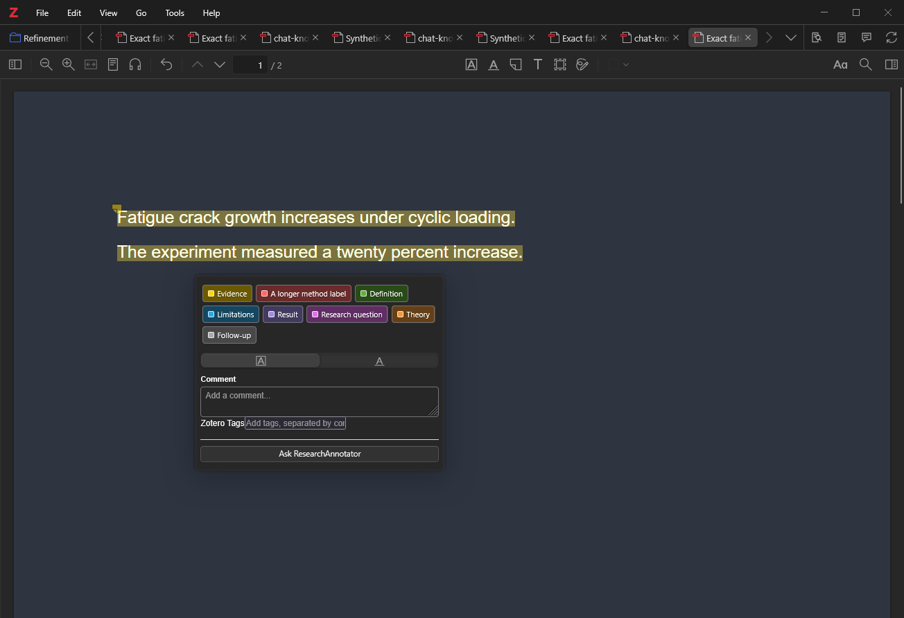

**Expected result:** the PDF popup displays your semantic labels; creating or recoloring a native annotation uses the chosen category. The screenshot demonstrates Wrap; all five modes remain selectable.

Open ResearchAnnotator settings → Colors. Give each color a semantic name, choose its hex color and configure Highlights/Areas and fields. Global fields apply across colors; color-specific fields belong to that configuration. Save changes.

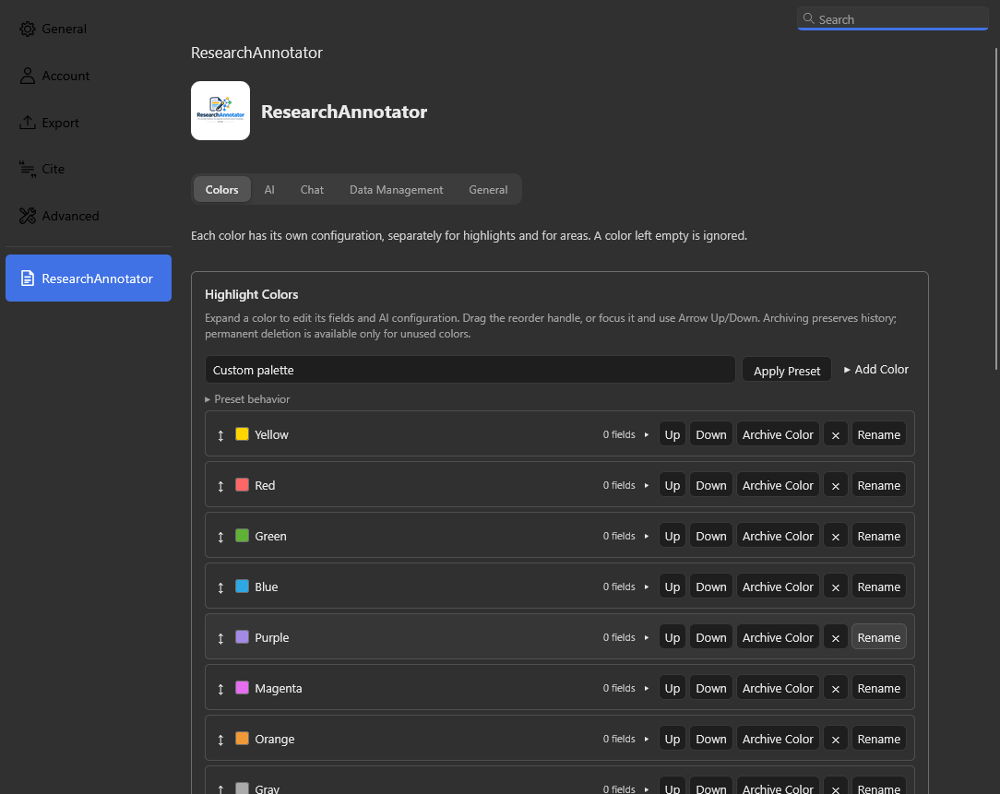

Use manual field types appropriate to your data, including categorical choices, multi-select values and checkboxes. Written by AI fields display their labels before generation and show Not generated yet when empty. AI fields are read-only in ordinary manual editing. Native Zotero Comment remains separate.

When AI fields exist, choose **AI Generation Trigger**:

- **Automatic:** queues missing AI fields when an annotation is created. Completed results are retained.
- **Manual:** use Generate AI Fields when you want generation.

Failed fields expose Retry in either mode. Changing instructions does not regenerate completed historical values. Use explicit batch workflows for missing historical fields. Automatic mode can incur provider costs when creating annotations; check it before a large session.

Color Label Layout offers Single Row, Wrap, Stacked, Slanted and Vertical. Research Note Order controls default grouping/order. Advanced inherited settings remain secondary compatibility tools; do not edit raw schemas without a backup.

## 2. Read, highlight and review

**What it does:** manual and AI fields add reusable research information while native Comments and Tags remain independent.

**How to use it**

1. In the expanded color editor, choose + Add field or a starter template. Set its label and manual type, or Written by AI with instructions; Save changes. Global Fields applies across colors.
2. If AI fields exist, select Automatic or Manual under AI Generation Trigger and save. Start with Manual if you want to control each request.
3. Highlight original PDF text. Open the annotation's field controls, enter manual information and save. For a manual AI field choose Generate AI Fields; for failure use that field's Retry.
4. Reopen the annotation and check its saved values. Add native Comments/Tags through Zotero without treating them as structured field values.

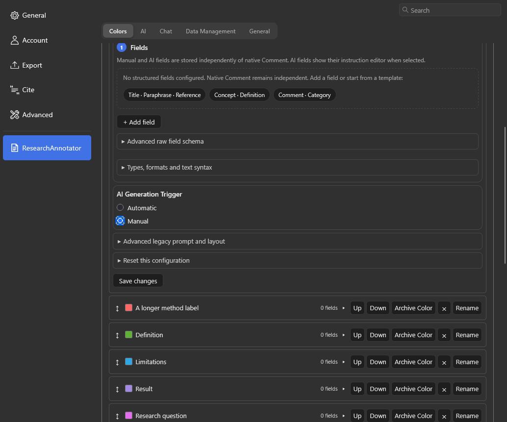

**Expected result:** configured labels remain visible before generation; successful values persist, completed AI values are not routinely regenerated and native Comments/Tags remain intact.

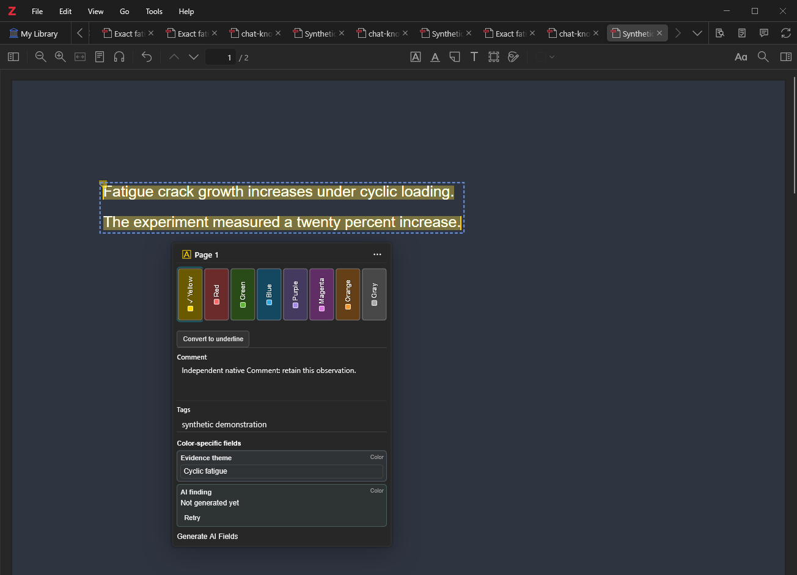

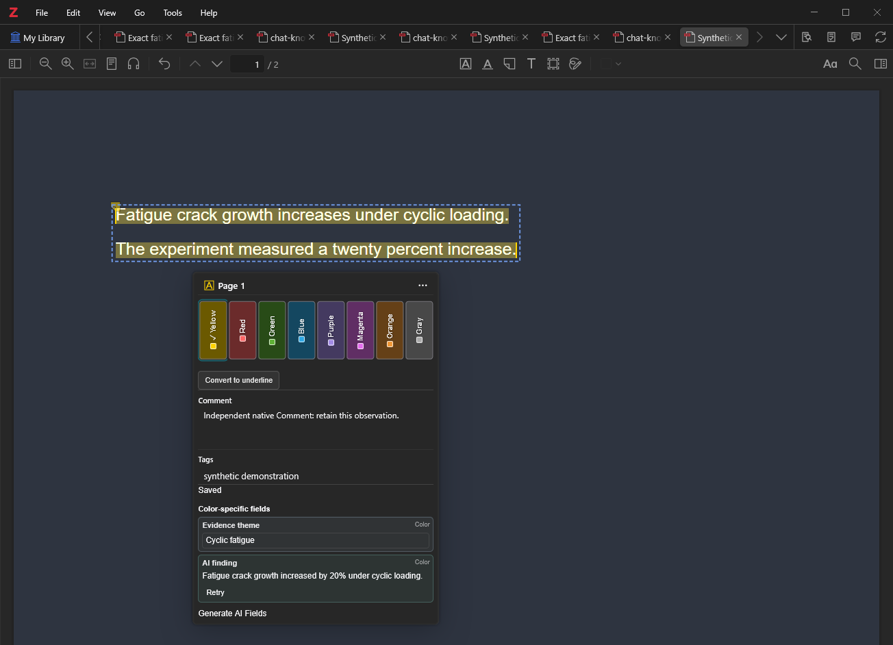

*These actual beta screenshots use a synthetic PDF and the already installed local qwen2.5:7b model. The native check confirms AI persistence and retention of the manual value, Comment and Tags. The current beta also displays Retry outside failed-field states; that is a documented UI limitation, not a reason to regenerate completed fields. The screenshot does not claim that visibility problem is fixed.*

Open a PDF in Zotero, select original text and choose a semantic color. Complete manual fields without replacing native Comments. Reopen an annotation to inspect saved fields. Use the independent Annotation Review toolbar button to identify missing configured values and distinguish missing, failed and outdated AI values. Retry or explicitly generate only what is needed.

Archive a color to remove it from ordinary use while preserving history. Permanent deletion is restricted by usage checks. Reassignment preserves stable historical field data; recoloring is not a field migration.

## 3. Search your research

**What it does:** Workspace brings annotation search, note creation/management, reusable searches, jobs and research relationships into one window.

**How to use it**

1. Click Research Workspace or use its Tools entry. Explorer: choose scope, enter words/filters and Search; expand a result for details/navigation.
2. Save a useful query, then open Saved Searches to manage/reopen it. Notes creates and manages notes; Activity shows jobs; Network organizes research entities.
3. Switch tabs without closing the window. Reopening Workspace focuses its existing window.

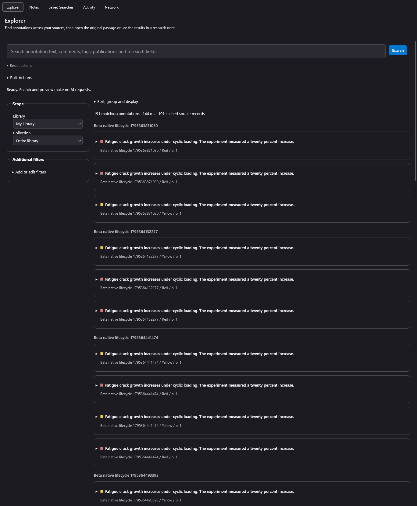

**Expected result:** matching annotations appear as cards with publication metadata; navigation opens original evidence. The test library contains repeated fixture entries; this is not a recommended research naming scheme.

Saved Searches, Activity and Network screenshots

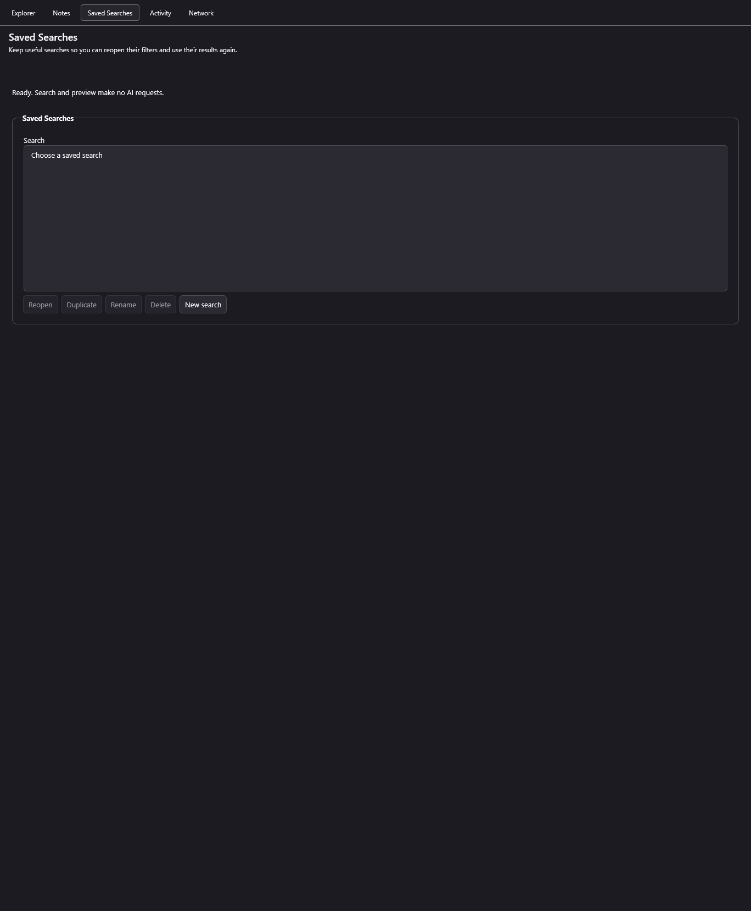

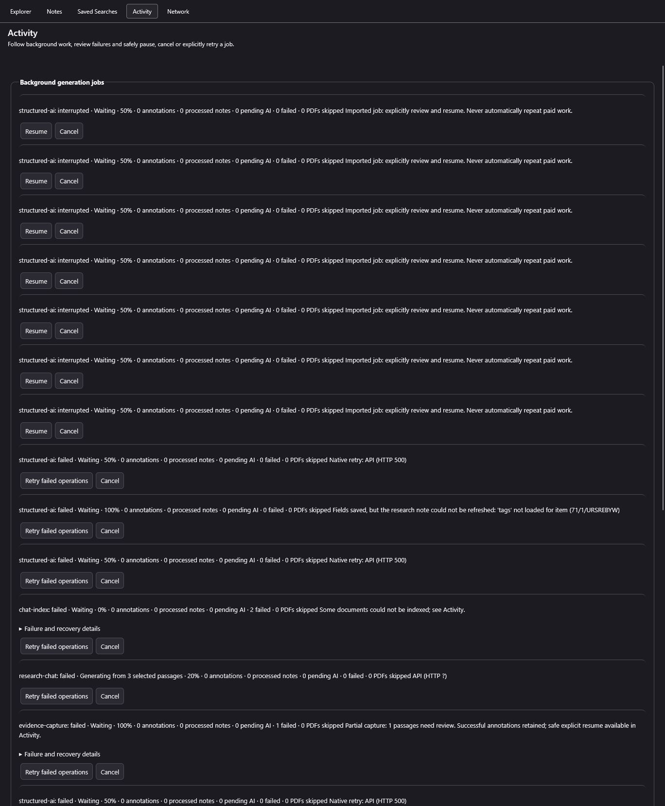

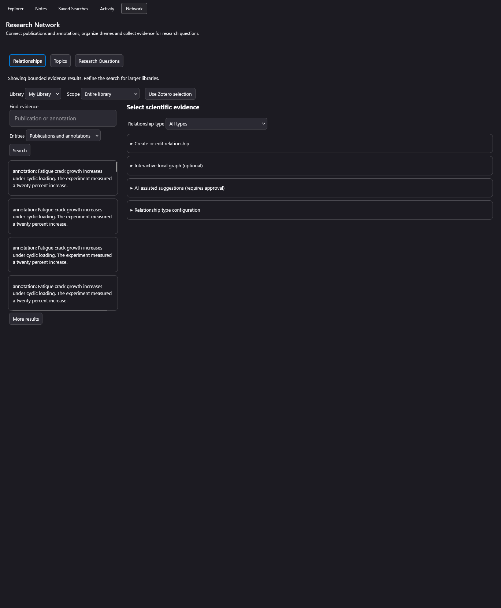

### Bulk Highlight Color Mapper

**What it does:** maps existing editable Zotero highlight colors to semantic categories in a recoverable batch.

**How to use it**

1. Select the PDFs you intend to change. In Explorer → Bulk Actions → Map Highlight Colors, choose the source scope.
2. Scan highlights. Review original hex groups, examples and counts. Similar RGB grouping is optional; skip existing semantic assignments is enabled by default.
3. Include wanted groups and choose destination semantic colors. Preview mapping and check how many annotations/PDFs will change.
4. Apply mapping and confirm. Monitor Activity for progress or supported cancellation/resume.
5. Refresh mapping history, select the operation and use Undo if needed. Review reported conflicts rather than replacing newer user edits.

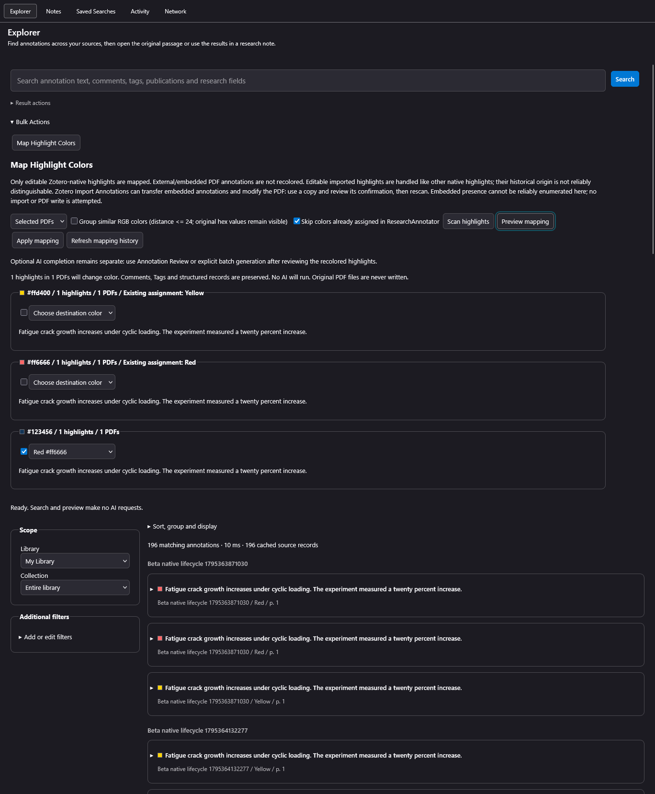

**Expected result:** only selected native annotation colors change; Comments, Tags and structured history remain. No AI request or PDF rewrite occurs.

Actual preview, application history and Undo result

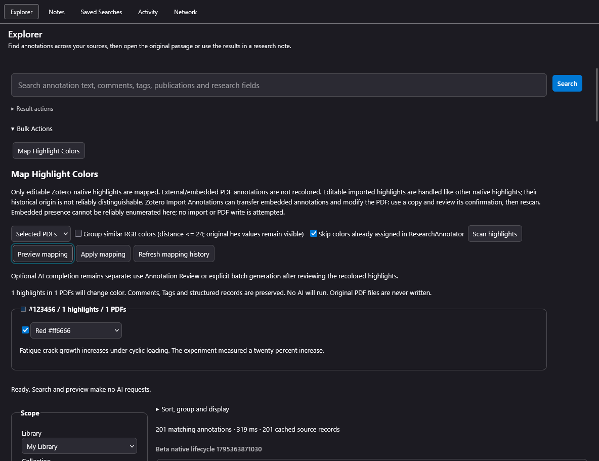

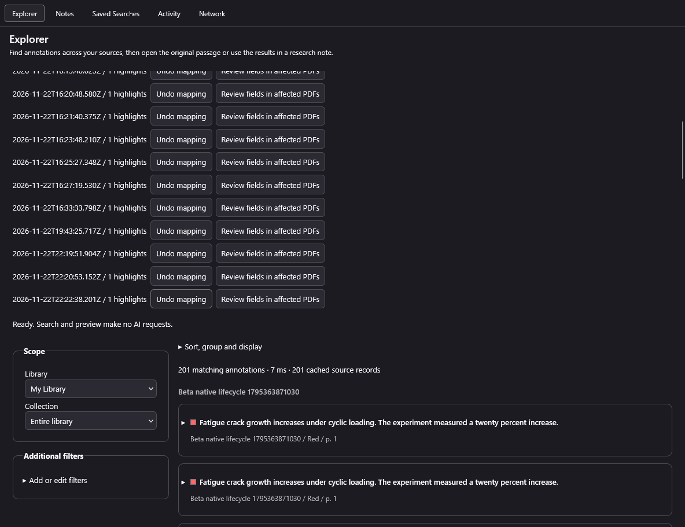

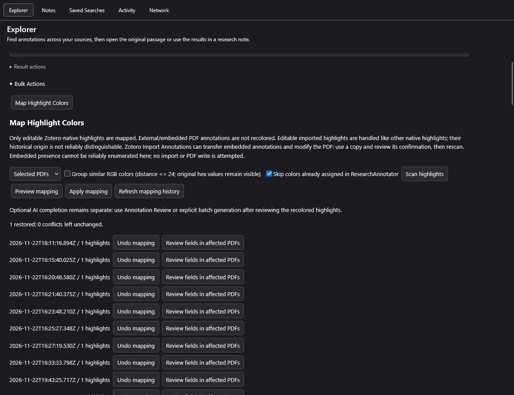

*This isolated final-beta sequence passed native apply, Undo, retained Comment and no-AI-request checks. The history contains older synthetic test operations; use the correct operation row in your own library. Newer edits are preserved as conflicts rather than indiscriminately reverted.*

Open Research Workspace → Explorer. Choose scope, enter search text and add field/color filters as needed. Inspect annotation results and use their navigation actions. Save a useful query in Saved Searches, then reopen it later. Background jobs appear in Activity, including failures and available pause/resume/cancel controls.

Bulk Actions → Map Highlight Colors scans native annotation colors. Review original colors/counts/examples, choose targets, preview and confirm. Library-wide scope needs extra care. Mapping changes native annotation colors without changing PDF bytes or requesting AI. Undo is available from mapping history; newer edits become conflicts rather than being overwritten. Exposed external annotations are excluded. Embedded annotations not exposed by Zotero cannot be reliably counted; use Zotero's own import workflow on a copy if needed.

## 4. Create and manage notes

**What it does:** compiles selected original highlights and fields into managed research notes while preserving authored blocks and stable note identity.

**How to use it**

1. In Notes choose a note type, source scope and content. Keep optional metadata off unless wanted.
2. Inspect destination and Preview, then Generate or update.
3. Switch to Manage existing notes to edit the selected configuration, title, destination or mode. Automatic refreshes on supported changes, Manual waits for explicit update and Static avoids routine refresh; explicit Apply/Reset ordering still rebuilds once.
4. Expand Research Note Order on an individual note to reorder its semantic groups. Apply or Reset; inspect authored content afterward.
5. Delete through management only when intended: management stops persistently. Use Recreate / Resume management to explicitly generate again. Use repair/restoration maintenance only with its backup and preview.

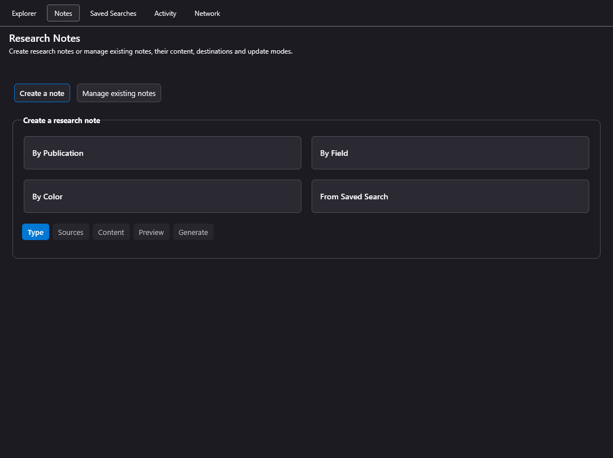

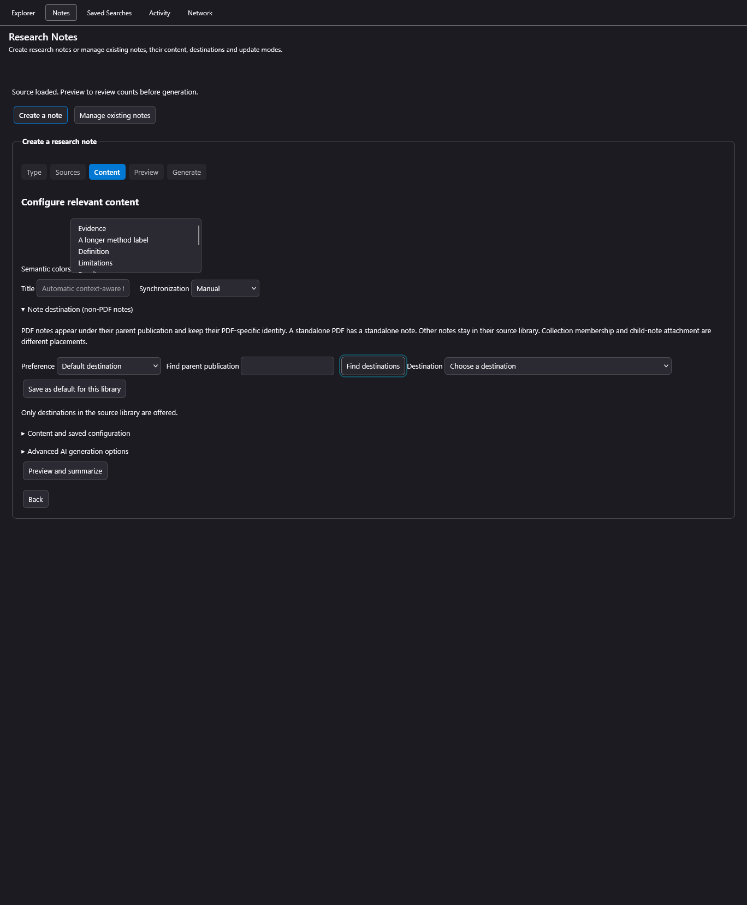

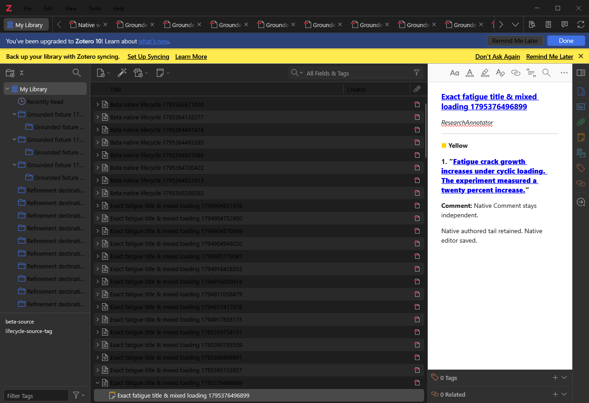

**Expected result:** a linked quotation, populated Comments/fields and genuine authored content coexist. Screenshot filenames do not determine the host theme; native chrome may be dark while the editor page is light.

Per-note ordering and management controls

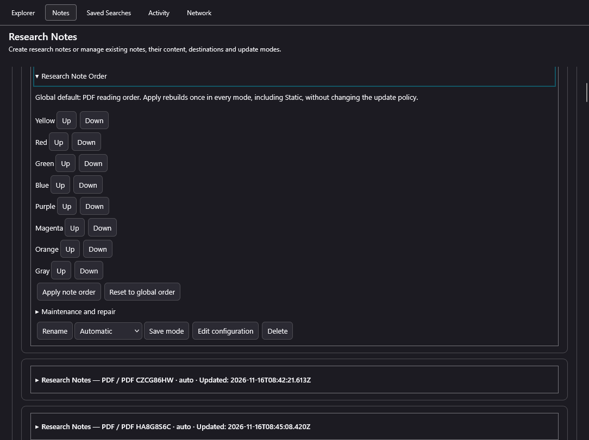

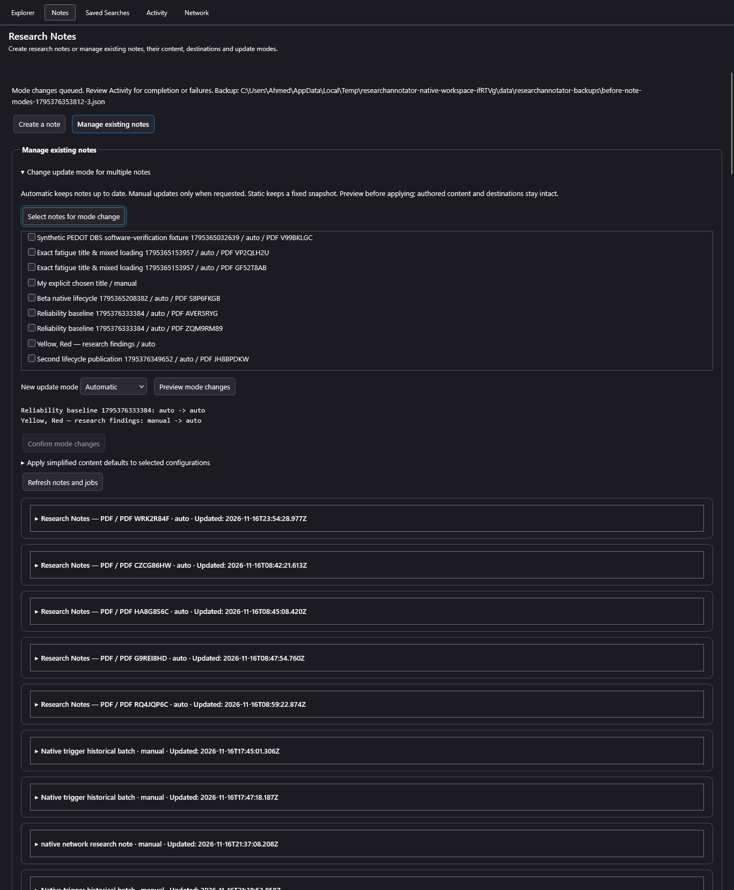

In Notes, use the creation workflow: choose By Publication, By Field, By Color or From Saved Search; choose scope; configure content; preview; generate/update. Contextual Network and other entry points preserve additional note modes. Advanced controls are secondary.

PDF notes use the parent publication title and retain their PDF association. Multiple attachments have independent managed identities. Other notes use field/value, semantic color, saved search or research context. Titles do not determine identity. Existing user-edited titles are preserved.

For non-PDF notes, preview the destination: library root, collection membership or child note of a publication. A collection is membership, not a parent item. Default, Ask every time and Remember last policies are available. Updates keep the current destination; use explicit Move to change it within supported library semantics. Unavailable destinations require a new valid selection rather than silent cross-library redirection.

Generated entries show linked quotations, semantic indicators, native Comments and populated fields. Extra metadata is optional. Authored paragraphs and rich blocks stay anchored relative to generated entries. When sorting or deleting neighbors, inspect the result: preservation is a positioning policy, not a guarantee that an arbitrary new sort can keep every old adjacency.

Use Manage existing notes for contextual configuration, title/destination changes, synchronization mode and per-note color order. Apply/Reset order is an explicit rebuild even for a Static note. Deleting a managed note stops its management persistently. Choose Recreate / Resume management only when you want it back. Repair/restoration are maintenance actions with recoverable backups; inspect previews and retain backups. Ordinary user blockquotes must not be removed indiscriminately.

## 5. Ask source-grounded questions

**What it does:** retrieves selected original PDF passages and supplies them to your configured generation model, with evidence references you can inspect.

**How to use it**

1. Open Research Chat. In Sources choose/search publications or PDFs and inspect their coverage.
2. Index selected sources. Keep Keyword only for the first question; it needs no embedding model.
3. Choose the generation model through provider/model settings. Ask a focused question, wait for the job and open a numbered inline citation.
4. Inspect its original excerpt and Open in PDF. Use Retrieval diagnostics if coverage or the answer is insufficient. Optional semantic/hybrid setup is in [Local AI setup](local-ai.md).

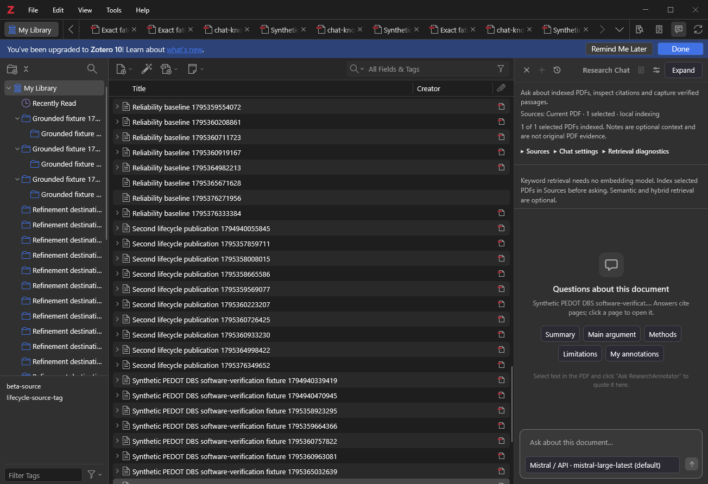

**Expected result:** answers cite supplied passages and distinguish source findings from interpretation. The response shown below is deterministic test output, not an actual local-model quality demonstration.

Open Research Chat from its independent toolbar button. Choose sources: current PDF/publication, selected publications, collection (optionally subcollections), library or custom selection. Search and select individual PDFs; publications may have multiple attachments. Inspect available/indexed/missing status.

Index selected sources locally before asking. Start in **Keyword only** mode: an embedding model is not required. Choose a generation provider separately. Ask a focused question using terminology likely to appear in the papers. Follow-ups retain conversation sources and retrieve new passages as needed.

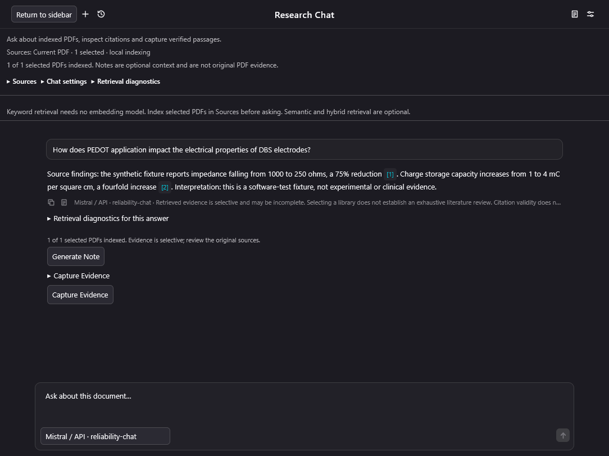

Open a citation to inspect publication, attachment, page and original excerpt, then Open in PDF. Reliable locations support passage navigation; otherwise navigation is to a page with the excerpt for reference. No highlight is created merely to navigate. A valid evidence ID does not prove that an interpretation is scientifically correct.

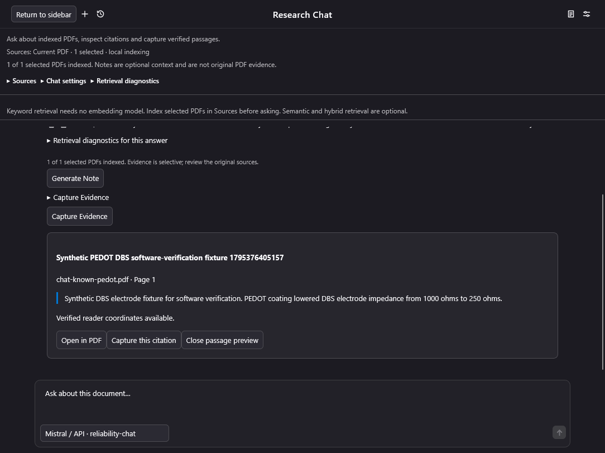

Use Expand for the full-size Chat window and Return to sidebar to switch back. Both views share conversations, sources and jobs. Reopening a conversation preserves citations, but changed/unavailable PDFs may prevent old locations from resolving safely.

Open secondary Retrieval diagnostics to see source coverage, retrieved passages, supplied evidence, failures and budget omissions. No indexed evidence, no matches and generation failure are different problems. Library scope never guarantees an exhaustive literature review.

## 6. Capture evidence and generate a note

**What it does:** converts validated original passages into native highlights, with common structured assignments if chosen.

**How to use it**

1. Open Capture Evidence for a citation or answer, select wanted passages and review existing matches.
2. Choose a common color and applicable fields; inspect conflict choices and the explicit missing-AI option.
3. Confirm, monitor Activity and review partial results. Use operation-level Undo where available; subsequent edits are preserved as conflicts.

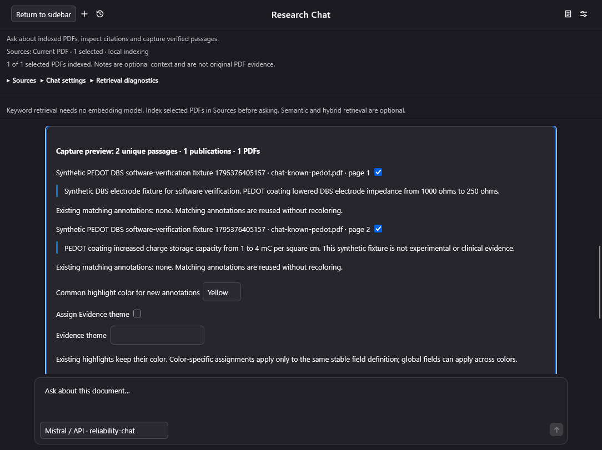

**Expected result:** resolvable original text becomes native Zotero highlights or reuses existing matches, with no duplicate highlights on repeated capture. Unresolved locations remain reported exceptions.

Capture one citation, selected citations or all cited evidence from an answer. Preview unique original passages, publications/PDFs, existing matches and unresolved locations. Exclude unwanted passages; choose a common color and applicable manual fields. Edit any suggested values before confirmation.

Matching existing annotations are reused by default. Preserve, merge where supported or explicitly replace conflicting values; never assume capture will safely overwrite them. Exact coordinates and unchanged document fingerprints are required for new highlights. Unresolved passages are reported separately, and the source PDF is not modified.

AI generation is an explicit capture option: review how it interacts with the color's Automatic/Manual trigger before confirmation. Operation history supports recoverable progress, partial results, restart and safe Undo. Undo removes newly created annotations or restores owned changes only where subsequent edits do not conflict; it does not indiscriminately delete pre-existing highlights.

Use Generate Note for a managed cross-publication note when appropriate. Optional research-question association and stable provenance connect captured evidence to the same shared Explorer, Notes, Review and Network data.

## 7. Organize research relationships

**What it does:** links annotations/publications through research relationships, topics and questions without treating interpretive links as original evidence.

**How to use it**

1. Open Network, choose Relationships, Topics or Research Questions and select/search an entity.
2. Use relevant contextual create/edit/delete controls and structured evidence-role editing.
3. Switch list/graph where offered; use advanced graph/type and explicit AI suggestion controls only when needed.

**Expected result:** details reflect the selected entity and saved relationships remain shared with the existing research data.

Network has Relationships, Topics and Research Questions. Select/search an entity, inspect relevant details and use contextual create/edit/delete actions. Switch list/graph views where available. Edit evidence roles through structured controls. AI suggestions, type configuration and advanced graph filters are secondary and require explicit initiation where AI is involved. Interpretive links are not original publication evidence.

## 8. Protect and troubleshoot data

Keep Zotero backups and ResearchAnnotator exports before imports, schema changes, repair or bulk work. Portable exports and local recovery journals serve different purposes; rebuildable indexes need not travel with research data. Cross-device automatic synchronization is not promised. See [troubleshooting](troubleshooting.md), [privacy](privacy.md) and [compatibility](compatibility.md).

## 9. Settings reference

**What it does:** configures annotation vocabulary, providers, Chat and data maintenance in the existing preference system.

**How to use it**

1. Open ResearchAnnotator settings and choose the relevant section below.
2. Make one small change; use Save changes where offered. Verify it with a disposable annotation before bulk work.
3. Export data before schema, import, repair or destructive changes.

| Section | Important controls |
| --- | --- |
| Colors | Semantic name/hex, Highlights/Areas, fields, conditional AI trigger; advanced schema/legacy controls stay secondary. |
| Global Fields | Shared manual/AI definitions across colors, independent of native Comments. |
| Color Label Layout | Five popup modes; remains expanded. |
| Research Note Order | Default order/grouping, with explicit per-note overrides. |
| AI | Provider, endpoint, installed model, generation parameters. Ollama instructions use actual labels. |
| Chat | Provider/model override, history and context controls; retrieval/embedding controls are secondary within Chat itself. |
| Data Management | Export/import and recovery-related tools; exports are not full Zotero backups. |
| General | Other extension preferences; inherited advanced features remain compatible. |

**Expected result:** preferences persist while historical identities/values remain compatible. Actual provider and embedding-control screenshots are in [Local AI setup](local-ai.md); complete real-model acceptance remains pending.

Chat, Data Management and General settings

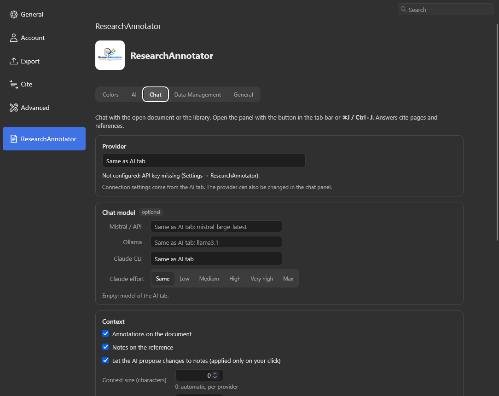

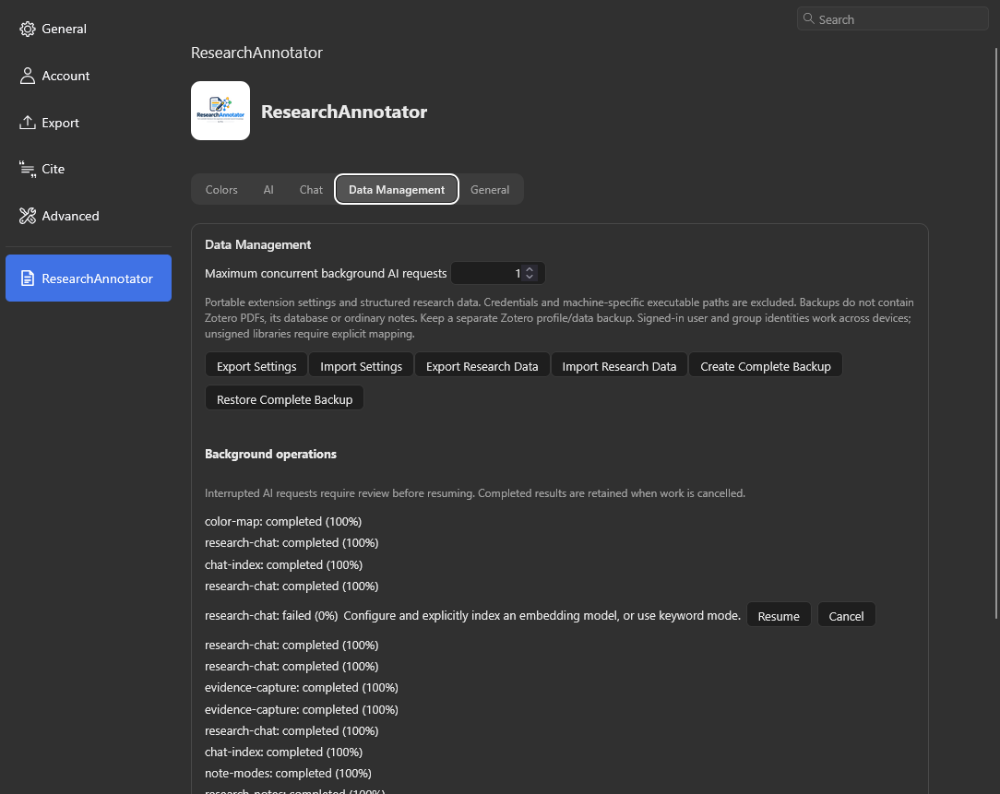

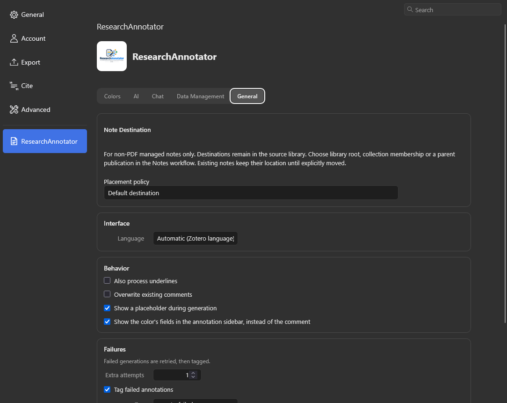

